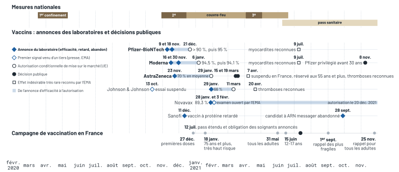
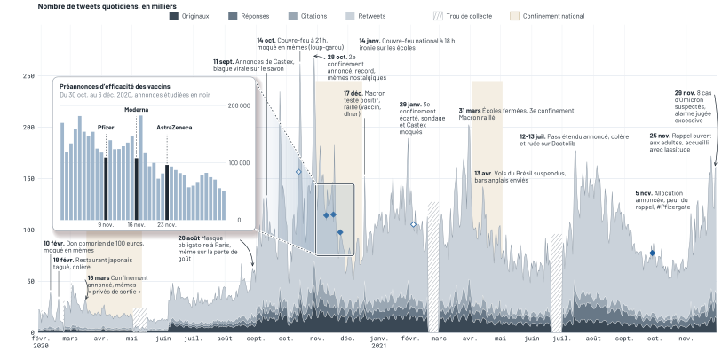
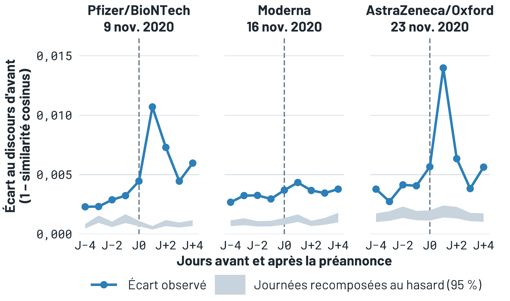
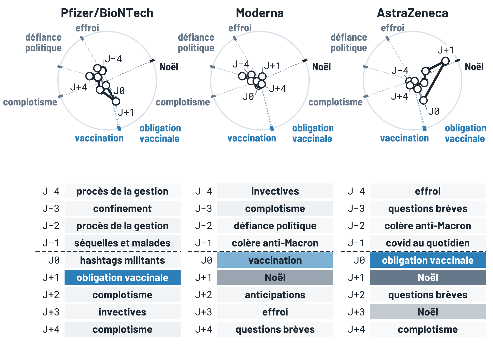
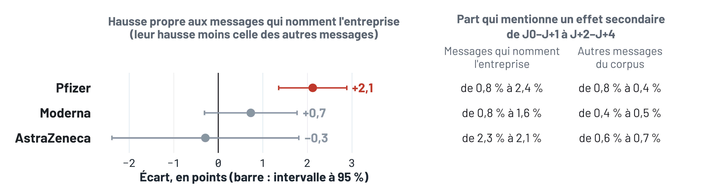
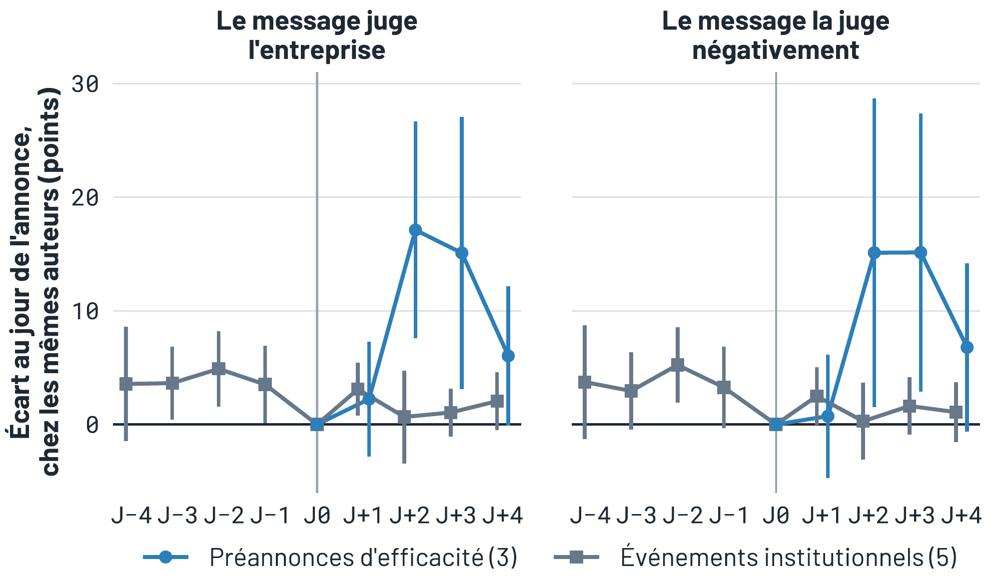
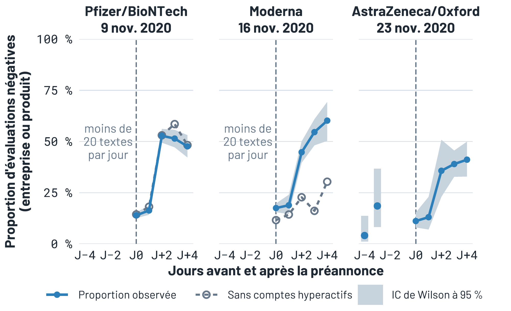
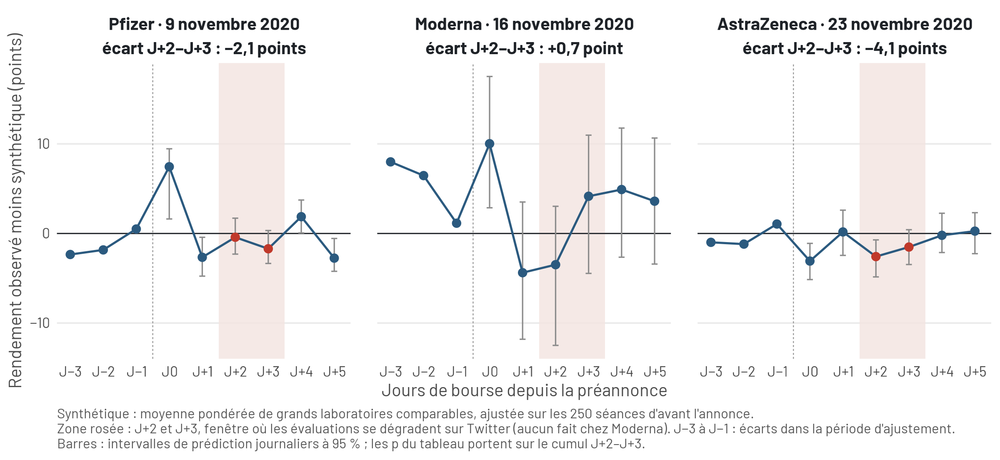

## {.cover}

<h1>Une approche dynamique de la réception des pré-annonces pharmaceutiques dans les réseaux sociaux</h1>
<div class="sub">Le cas des vaccins contre la Covid-19 sur Twitter</div>
<div class="rule"></div>
<div class="who two"><div><b>Olivier Caron</b><br>Université Paris Dauphine - PSL</div><div><b>Christophe Benavent</b><br>Université Paris Dauphine - PSL</div></div>
<div class="event">JIMS 2026 - 9ème Journée Internationale du Marketing Santé · IAE Lille, 14 octobre 2026</div>

::: {.notes}
- Bonjour, merci aux organisateurs
- Question : que devient une **préannonce pharmaceutique** dans la **conversation publique** ?
- Deux objets suivis : le **message** et l'**entreprise qui le porte**
- Terrain : les **vaccins Covid-19**, novembre 2020, **Twitter francophone**
- **→ d'abord le contexte**
:::

## Les préannonces arrivent six à dix semaines avant l'autorisation européenne {#contexte .v3}

<div class="navbar"><span class="on"><a href="#contexte">Contexte</a></span><span><a href="#litterature">Littérature</a></span><span><a href="#question">Question</a></span><span><a href="#modele">Modèle</a></span><span><a href="#methode">Méthode</a></span><span><a href="#resultats">Résultats</a></span><span><a href="#discussion">Discussion</a></span></div>

<div class="figfull"></div>

::: {.notes}
- **3 préannonces en 2 semaines**, espacées de **7 jours**
- 9 nov. : **Pfizer et BioNTech, 90 %**, essai de phase 3 encore en cours
- 16 nov. : **Moderna, 94,5 %**
- 23 nov. : **AstraZeneca et Oxford, 70 % en moyenne** de deux protocoles
- Résultats **intermédiaires**, plusieurs semaines avant l'article scientifique (un mois pour Pfizer)
- Un communiqué de presse, **information financière réglementée**, aussitôt repris par **le grand public**
- En Europe, c'est l'un des **rares canaux** par lesquels le laboratoire parle lui-même au public
- La frise entière : 2e confinement et couvre-feu au moment des préannonces · d'autres laboratoires apparaissent (Johnson & Johnson, Novavax, Sanofi), avec d'autres calendriers · premières doses en France le 27 décembre, avant l'autorisation de Moderna et d'AstraZeneca
- Six semaines pour Pfizer (9 novembre → 21 décembre), sept pour Moderna (16 novembre → 6 janvier), un peu plus de neuf pour AstraZeneca (23 novembre → 29 janvier) · Pfizer et Moderna publient une mise à jour de leur chiffre entre-temps (95 %, 94,1 %)
- Examen continu : AstraZeneca dès le 1er octobre, Pfizer début octobre, Moderna à la mi-novembre
- Les autorités et les revues scientifiques viennent **ensuite** : elles peuvent confirmer ou contredire l'entreprise
- La France compte parmi les pays où la **défiance vaccinale** est la plus forte (Larson, 2020)
- **Aucun vaccin autorisé** dans l'UE au moment des préannonces
- **Examen continu** (rolling review) de l'EMA : déjà engagé, **mais aucune décision publiée**
- Autorisations conditionnelles : **21 décembre, 6 janvier, 29 janvier**
- Le communiqué de l'entreprise est donc **la première communication des résultats d'efficacité**
- Vocabulaire : l'entreprise émet un **signal** sur son produit · les autorités émettent ensuite des **signaux de tiers**
- Public très concerné : **défiance vaccinale forte en France**
- **→ que dit la littérature des préannonces ?**
:::

## La préannonce vise à influencer le marché avant le lancement du produit {#litterature .v3}

<div class="navbar"><span class="done"><a href="#contexte">Contexte</a></span><span class="on"><a href="#litterature">Littérature</a></span><span><a href="#question">Question</a></span><span><a href="#modele">Modèle</a></span><span><a href="#methode">Méthode</a></span><span><a href="#resultats">Résultats</a></span><span><a href="#discussion">Discussion</a></span></div>

<ul class="litt">
<li>Informer avant le lancement : clients, concurrents, partenaires, investisseurs<span class="ref">Eliashberg &amp; Robertson, 1988 · Sorescu et al., 2007</span></li>
<li>Préempter une position et dissuader les concurrents<span class="ref">Heil &amp; Robertson, 1991 · Robertson, Eliashberg &amp; Rymon, 1995 · Bayus, Jain &amp; Rao, 2001</span></li>
<li>Faire attendre les acheteurs<span class="ref">Sorescu et al., 2007 · Su &amp; Rao, 2011</span></li>
<li>Mais aussi provoquer des ripostes<span class="ref">Robertson et al., 1995 · Ofek &amp; Turut, 2013</span></li>
<li>Engager la crédibilité de l'entreprise par ses promesses<span class="ref">Eliashberg &amp; Robertson, 1988 · Sorescu et al., 2007</span></li>
</ul>

```{=html}
<svg viewBox="0 0 1260 150" width="84%" style="display:block;margin:30px auto 0" font-family="Barlow, sans-serif" xmlns="http://www.w3.org/2000/svg">
<defs><marker id="fk" viewBox="0 0 10 10" refX="9" refY="5" markerWidth="8" markerHeight="8" orient="auto"><path d="M0,0 L10,5 L0,10 z" fill="#5b6672"/></marker></defs>
<text x="4" y="20" font-size="17" font-weight="700" fill="#5b6672" letter-spacing="1">LITTÉRATURE</text>
<line x1="4" y1="30" x2="640" y2="30" stroke="#c9d1d9" stroke-width="2"/>
<rect x="2" y="44" width="310" height="70" rx="10" fill="#f4f6f8" stroke="#c9d1d9" stroke-width="2"/>
<text x="157" y="87" text-anchor="middle" font-size="25" fill="#1f2328">La firme envoie un signal</text>
<line x1="316" y1="79" x2="362" y2="79" stroke="#5b6672" stroke-width="2" marker-end="url(#fk)"/>
<rect x="368" y="44" width="272" height="70" rx="10" fill="#f4f6f8" stroke="#c9d1d9" stroke-width="2"/>
<text x="504" y="87" text-anchor="middle" font-size="25" fill="#1f2328">La bourse réagit</text>
<line x1="644" y1="79" x2="690" y2="79" stroke="#5b6672" stroke-width="2" marker-end="url(#fk)"/>
<text x="698" y="20" font-size="17" font-weight="700" fill="#c0392b" letter-spacing="1">NOTRE ANGLE</text>
<line x1="698" y1="30" x2="1256" y2="30" stroke="#c0392b" stroke-width="2"/>
<rect x="696" y="44" width="560" height="70" rx="10" fill="#fff" stroke="#c0392b" stroke-width="2.4"/>
<text x="976" y="87" text-anchor="middle" font-size="25" font-weight="700" fill="#c0392b">Le public transforme le message <tspan font-size="20" font-weight="400" fill="#5b6672">(Twitter)</tspan></text>
</svg>
```
<p class="chaine-ref">Kozinets et al., 2010 · Gyftopoulos et al., 2024</p>

::: {.notes}
- **À dire** : « La préannonce sert à agir avant le lancement : préparer la demande, préempter, dissuader. Mais elle engage aussi son émetteur. Nous regardons ce qui se passe quand elle circule auprès d'un public élargi. »
- Ce sont des **fonctions possibles** établies par la littérature, pas des effets démontrés dans notre cas · *si question : dans la course aux vaccins, préempter peut vouloir dire être le premier à afficher un taux d'efficacité au moment où les États choisissent leurs fournisseurs. Lecture possible, non testée*
- Préannonce = annonce **avant la mise sur le marché** (Eliashberg et Robertson)
- **Théorie du signal** : réduire l'incertitude (Spence) · plus crédible quand elle **engage la réputation** (Kirmani et Rao)
- Ce que l'on mesure : **le cours de bourse** (Sorescu et al., 2007), les réactions des **concurrents**
- Ce qui manque : **la réception publique**
    - la préannonce **sort de son audience** et entre dans une conversation qui **transforme** les messages
- **→ trois cadres pour suivre le message, puis l'émetteur, dans la conversation**
:::

## Comment la conversation publique transforme-t-elle la préannonce et son émetteur ? {#question .v3}

<div class="navbar"><span class="done"><a href="#contexte">Contexte</a></span><span class="done"><a href="#litterature">Littérature</a></span><span class="on"><a href="#question">Question</a></span><span><a href="#modele">Modèle</a></span><span><a href="#methode">Méthode</a></span><span><a href="#resultats">Résultats</a></span><span><a href="#discussion">Discussion</a></span></div>

<table class="synth questions">
<tr><th>Objet</th><th>Question</th><th>Cadre</th><th>Hypothèse</th></tr>
<tr><td class="h">Le message</td><td>Le discours s'éloigne-t-il de la préannonce, puis y revient-il ? Vers quels thèmes ?</td><td class="cad">Transmission sociale<span>Bartlett, 1932 · Jacobs &amp; Campbell, 1961</span></td><td class="hy">H1, P1</td></tr>
<tr><td class="h">Le risque</td><td>Les effets secondaires sont-ils davantage mentionnés après la préannonce ?</td><td class="cad">Amplification du risque<span>Kasperson et al., 1988</span></td><td class="hy">H2</td></tr>
<tr><td class="h">L'émetteur</td><td>Le public passe-t-il du contenu du message au jugement de l'entreprise ?</td><td class="cad">Mise en cause<span>Coombs, 2007</span></td><td class="hy">H3a</td></tr>
<tr><td class="h">La source</td><td>Le passage au jugement est-il plus faible quand la nouvelle émane d'un tiers ?</td><td class="cad">Légitimité<span>Suchman, 1995</span></td><td class="hy">H3b</td></tr>
</table>

::: {.notes}
- **Transmission sociale** (Bartlett) : les relais **omettent, simplifient, assimilent**
    - Jacobs et Campbell : une norme **persiste un temps puis revient** vers son niveau
- **Amplification sociale du risque** (Kasperson) : le risque se construit **en circulant**, amplifié ou atténué
- **Mise en cause** (Coombs) : la réputation souffre quand on **attribue une responsabilité**
    - mais ici le point de départ est **une bonne nouvelle**, pas une crise
- **Légitimité** (Suchman) : l'entreprise **intéressée** et l'autorité **qui évalue** ne parlent pas **depuis la même position**
- **À dire** : la préannonce entre dans la conversation publique. Nous décomposons la question en quatre objets, chacun lié à une hypothèse
- Une préannonce met **deux objets** en circulation : **un message** et **celui qui le porte**
- Question : **évoluent-ils au même rythme** ?
- **Le message** : de combien le discours s'éloigne, revient-il, vers quoi, et le risque
- **L'émetteur** : l'entreprise devient-elle la **cible** de la discussion ?
- **La source** : est-ce différent quand **un tiers** apporte la nouvelle ?
- **→ le modèle**
:::

## Une préannonce met en circulation un message et l'entreprise qui le porte {#modele .v3}

<div class="navbar"><span class="done"><a href="#contexte">Contexte</a></span><span class="done"><a href="#litterature">Littérature</a></span><span class="done"><a href="#question">Question</a></span><span class="on"><a href="#modele">Modèle</a></span><span><a href="#methode">Méthode</a></span><span><a href="#resultats">Résultats</a></span><span><a href="#discussion">Discussion</a></span></div>

<div class="modele big"><svg viewBox="-3 0 1447 648" xmlns="http://www.w3.org/2000/svg" role="img" aria-label="Modèle conceptuel">
<defs><marker id="ah" viewBox="0 0 10 10" refX="9" refY="5" markerWidth="9" markerHeight="9" orient="auto-start-reverse"><path d="M0,0 L10,5 L0,10 z" fill="#1f2328"/></marker></defs>
<g font-family="Barlow, sans-serif" fill="#1f2328">
<rect x="335" y="78" width="400" height="408" rx="8" fill="none" stroke="#8a96a3" stroke-width="2" stroke-dasharray="9 7"/>
<text x="535" y="64" text-anchor="middle" font-size="21" font-style="italic" fill="#5b6672">Conversation publique</text>
<rect x="0" y="215" width="250" height="150" rx="8" fill="#eef3f8" stroke="#2b5a7f" stroke-width="3"/>
<text x="125" y="250" text-anchor="middle" font-size="25" font-weight="700">Préannonce</text>
<text x="125" y="278" text-anchor="middle" font-size="25" font-weight="700">d'efficacité</text>
<text x="125" y="310" text-anchor="middle" font-size="20">la nouvelle émane</text>
<text x="125" y="334" text-anchor="middle" font-size="20">de l'entreprise</text>
<rect x="385" y="120" width="250" height="70" rx="8" fill="#fff" stroke="#1f2328" stroke-width="2.5"/>
<text x="510" y="164" text-anchor="middle" font-size="26" font-weight="700">Le message</text>
<rect x="385" y="390" width="250" height="70" rx="8" fill="#fff" stroke="#1f2328" stroke-width="2.5"/>
<text x="510" y="434" text-anchor="middle" font-size="26" font-weight="700">L'entreprise</text>
<line x1="250" y1="290" x2="383" y2="158" stroke="#1f2328" stroke-width="2.5" marker-end="url(#ah)"/>
<line x1="250" y1="290" x2="383" y2="422" stroke="#1f2328" stroke-width="2.5" marker-end="url(#ah)"/>
<line x1="635" y1="155" x2="1078" y2="66" stroke="#1f2328" stroke-width="2.5" marker-end="url(#ah)"/>
<line x1="635" y1="155" x2="1078" y2="185" stroke="#1f2328" stroke-width="2.5" stroke-dasharray="9 7" marker-end="url(#ah)"/>
<line x1="635" y1="155" x2="1078" y2="304" stroke="#1f2328" stroke-width="2.5" marker-end="url(#ah)"/>
<line x1="635" y1="425" x2="1078" y2="425" stroke="#1f2328" stroke-width="2.5" marker-end="url(#ah)"/>
<text x="850" y="100" text-anchor="middle" transform="rotate(-11.4 850 100)" font-size="20" font-style="italic" fill="#5b6672">transmission sociale</text>
<text x="890" y="160" text-anchor="middle" transform="rotate(3.9 890 160)" font-size="19" font-style="italic" fill="#5b6672">assimilation aux débats existants</text>
<text x="862" y="212" text-anchor="middle" transform="rotate(18.6 862 212)" font-size="20" font-style="italic" fill="#5b6672">amplification du risque</text>
<text x="780" y="412" font-size="20" font-style="italic" fill="#5b6672">mise en cause</text>
<g font-size="26" font-weight="700" text-anchor="middle">
<circle cx="1030" cy="76" r="17" fill="#fff" stroke="#1f2328" stroke-width="2.2"/><text x="1030" y="85">+</text>
<circle cx="1030" cy="288" r="17" fill="#fff" stroke="#1f2328" stroke-width="2.2"/><text x="1030" y="297">+</text>
<circle cx="1030" cy="425" r="17" fill="#fff" stroke="#1f2328" stroke-width="2.2"/><text x="1030" y="434">+</text>
</g>
<g font-size="20" font-weight="700" fill="#2b5a7f">
<text x="1082" y="22">H1</text><text x="1082" y="142">P1 <tspan font-weight="400" font-style="italic" fill="#5b6672">lecture qualitative</tspan></text><text x="1082" y="262">H2</text><text x="1082" y="382">H3a</text>
</g>
<rect x="1082" y="32" width="358" height="74" rx="8" fill="#fff" stroke="#2b5a7f" stroke-width="2.5"/>
<text x="1261" y="64" text-anchor="middle" font-size="22">Écart du discours</text><text x="1261" y="92" text-anchor="middle" font-size="22">puis retour partiel</text>
<rect x="1082" y="152" width="358" height="74" rx="8" fill="#fff" stroke="#2b5a7f" stroke-width="2.5" stroke-dasharray="9 7"/>
<text x="1261" y="184" text-anchor="middle" font-size="22">Rattachement à des thèmes</text><text x="1261" y="212" text-anchor="middle" font-size="22">déjà présents</text>
<rect x="1082" y="272" width="358" height="74" rx="8" fill="#fff" stroke="#2b5a7f" stroke-width="2.5"/>
<text x="1261" y="304" text-anchor="middle" font-size="22">Mentions</text><text x="1261" y="332" text-anchor="middle" font-size="22">d'effets secondaires</text>
<rect x="1082" y="392" width="358" height="74" rx="8" fill="#fbf1ef" stroke="#c0392b" stroke-width="2.5"/>
<text x="1261" y="424" text-anchor="middle" font-size="22">Passage au jugement</text><text x="1261" y="452" text-anchor="middle" font-size="22">de l'entreprise</text>
<circle cx="950" cy="425" r="6" fill="#1f2328"/>
<line x1="950" y1="532" x2="950" y2="434" stroke="#1f2328" stroke-width="2.5" marker-end="url(#ah)"/>
<circle cx="950" cy="505" r="17" fill="#fff" stroke="#1f2328" stroke-width="2.2"/><text x="950" y="514" text-anchor="middle" font-size="28" font-weight="700">−</text>
<text x="978" y="512" font-size="20" font-weight="700" fill="#2b5a7f">H3b</text>
<rect x="740" y="535" width="420" height="104" rx="8" fill="#eceff2" stroke="#8a96a3" stroke-width="2"/>
<text x="950" y="566" text-anchor="middle" font-size="22" font-weight="700">Événement institutionnel</text>
<text x="950" y="595" text-anchor="middle" font-size="20">la nouvelle émane d'un tiers</text>
<text x="950" y="623" text-anchor="middle" font-size="18" fill="#5b6672">autorité sanitaire, revue scientifique</text>
</g></svg></div>


::: {.notes}
- Une préannonce → **deux objets** dans la conversation
- **Le message**
    - **H1** : il s'écarte puis **revient en partie** (transmission sociale)
    - **P1** : il rejoint des **thèmes déjà là** (assimilation, lecture qualitative)
    - **H2** : plus de **mentions d'effets secondaires** · l'amplification sociale du risque admet aussi l'atténuation : H2 teste l'attente d'une hausse
- **L'entreprise**
    - **H3a** : (a) **passage à l'évaluation** · (b) **valence** négative
    - **H3b** : plus faible quand la nouvelle **vient d'un tiers** (signe −)
- « + » : effet attendu
- **→ comment on mesure**
:::

## Un corpus de 50,2 millions de tweets en français sur la Covid, de janvier 2020 à novembre 2021 {#methode .v3}

<div class="navbar"><span class="done"><a href="#contexte">Contexte</a></span><span class="done"><a href="#litterature">Littérature</a></span><span class="done"><a href="#question">Question</a></span><span class="done"><a href="#modele">Modèle</a></span><span class="on"><a href="#methode">Méthode</a></span><span><a href="#resultats">Résultats</a></span><span><a href="#discussion">Discussion</a></span></div>

<p class="soustitre">Corpus constitué par Mihai Calciu, réhydraté de COVID-19-TweetIDs (Chen et al., 2020)</p>

<div class="figbas"></div>


::: {.notes}
- Encart : environ **100 000 tweets par jour** sur la Covid. Les jours des préannonces (en noir) **ne font pas de pic** · la préannonce tombe dans une conversation déjà occupée par d'autres sujets (confinement, Noël, politique)
- **Étapes A** : retenir les citations et réponses aux médias et institutions → situer chaque message dans un espace de sens (CamemBERT) → résumer chaque jour → comparer à des journées recomposées au hasard (H1) → nommer les thèmes (P1)
- **Étapes B** : retenir les mentions (Pfizer, BioNTech, Comirnaty…) → trois modèles de langage annotent l'évaluation de l'entreprise ou de son produit → effets secondaires comparés aux autres messages (H2) → chaque auteur comparé à lui-même (H3a) → même mesure quand l'entreprise ne parle pas (H3b)
- Effectifs : conversation Pfizer 22 459, Moderna 15 237, AstraZeneca 10 036 · mentions 4 956, 2 189, 838 textes distincts
- Jours : civils (heure de Paris) pour la conversation, UTC pour les effets secondaires, tranches de 24 h depuis l'annonce pour l'évaluation
- **50,2 millions** de tweets en français, **3 millions** de comptes
- **3 préannonces** + **5 événements institutionnels** sur les mêmes vaccins
    - vaccination au Royaume-Uni, NEJM et FDA, autorisation de l'EMA, avis de la HAS, thromboses AstraZeneca
- Fenêtre **J−4 à J+4** : les préannonces sont à **7 jours** d'écart → plus long = la suivante entre dans la fenêtre
- **Colonne A, le message** : citations et réponses à des messages des pôles **médias nationaux et médico-institutionnel**, sans mention d'effet secondaire dans le message initial, reprises par au moins **deux communautés**. Seuls les auteurs présents dans le réseau antérieur au 13 octobre sont retenus
    - ces messages peuvent ne nommer ni le vaccin ni l'entreprise : on suit **le contenu moyen de la conversation**, pas des chaînes de transmission du communiqué
- **Colonne B, l'émetteur** : nommer l'entreprise suffit · pour l'évaluation, textes identiques comptés une fois par jour. Pour les effets secondaires, tous les tweets retenus, avec des contrôles sans doublons
- Retweets **exclus** : ils copient sans transformer ni évaluer
- *Si question : communautés de comptes repérées par l'algorithme de Leiden dans le réseau de retweets arrêté au 13 octobre 2020, avant les fenêtres*
- *Si question : les fenêtres se chevauchent. La référence de Moderna et d'AstraZeneca peut déjà être influencée par la préannonce précédente, ce qui limite la comparaison directe des amplitudes entre les trois cas. La référence de Pfizer n'est pas concernée*
- **→ la mesure du discours, concrètement**
:::

## Chaque jour devient un point dans un espace sémantique, comparé aux quatre jours d'avant {.v3}

<div class="navbar"><span class="done"><a href="#contexte">Contexte</a></span><span class="done"><a href="#litterature">Littérature</a></span><span class="done"><a href="#question">Question</a></span><span class="done"><a href="#modele">Modèle</a></span><span class="on"><a href="#methode">Méthode</a></span><span><a href="#resultats">Résultats</a></span><span><a href="#discussion">Discussion</a></span></div>

<!-- carte-sens debut : genere par scripts/figures_diapo/carte_sens_svg.py, ne pas editer a la main -->
```{=html}
<svg viewBox="0 0 1500 600" width="100%" style="max-height:640px" font-family="Barlow, sans-serif" xmlns="http://www.w3.org/2000/svg">
<defs><marker id="flm" viewBox="0 0 10 10" refX="9" refY="5" markerWidth="7" markerHeight="7" orient="auto-start-reverse"><path d="M0,0 L10,5 L0,10 z" fill="#5b6672"/></marker></defs>
<text x="0" y="30" font-size="25" font-weight="700" fill="#1f2328">1. Chaque message devient une suite de nombres</text>
<rect x="0" y="52" width="520" height="186" rx="9" fill="#fff" stroke="#cfd6dd" stroke-width="1.4"/>
<text x="14" y="76" font-size="16" fill="#1f2328"><tspan font-weight="700">Michèle Rivasi</tspan><tspan fill="#5b6672"> @MicheleRivasi · J+1</tspan></text>
<text x="14" y="100" font-size="16" fill="#1f2328">Il est irresponsable de parler d&#x27;obligation vaccinale</text>
<text x="14" y="121" font-size="16" fill="#1f2328">sur un vaccin dont on connaît rien de l&#x27;efficacité et de</text>
<text x="14" y="142" font-size="16" fill="#1f2328">l&#x27;innocuité. Les chiffres donnés par @pfizer concernent</text>
<text x="14" y="163" font-size="16" fill="#1f2328">seulement 94 volontaires. Pour l&#x27;heure il ne s&#x27;agit que</text>
<text x="14" y="184" font-size="16" fill="#1f2328">d&#x27;un bon coup commercial et financier pour ce labo !</text>
<text x="14" y="205" font-size="16" fill="#1f2328">https://t.co/KfGLqqqh16</text>
<text x="14" y="226" font-size="14" fill="#5b6672">436 j'aime · 227 retweets</text>
<line x1="260" y1="242" x2="260" y2="272" stroke="#5b6672" stroke-width="2" marker-end="url(#flm)"/>
<rect x="150" y="276" width="220" height="46" rx="8" fill="#fff" stroke="#1f2328" stroke-width="1.6"/><text x="260" y="306" text-anchor="middle" font-size="21" font-weight="700" fill="#1f2328">CamemBERT</text><text x="382" y="296" font-size="16" fill="#5b6672">modèle de langue</text><text x="382" y="315" font-size="16" fill="#5b6672">entraîné sur du français</text>
<line x1="260" y1="324" x2="260" y2="352" stroke="#5b6672" stroke-width="2" marker-end="url(#flm)"/>
<rect x="4" y="356" width="80" height="44" rx="6" fill="#fff" stroke="#2b5a7f" stroke-width="1.6"/><text x="44" y="385" text-anchor="middle" font-size="18" font-family="Roboto Mono, monospace" fill="#1f2328">0,032</text>
<rect x="90" y="356" width="80" height="44" rx="6" fill="#fff" stroke="#2b5a7f" stroke-width="1.6"/><text x="130" y="385" text-anchor="middle" font-size="18" font-family="Roboto Mono, monospace" fill="#1f2328">−0,063</text>
<rect x="176" y="356" width="80" height="44" rx="6" fill="#fff" stroke="#2b5a7f" stroke-width="1.6"/><text x="216" y="385" text-anchor="middle" font-size="18" font-family="Roboto Mono, monospace" fill="#1f2328">−0,006</text>
<rect x="262" y="356" width="80" height="44" rx="6" fill="#fff" stroke="#2b5a7f" stroke-width="1.6"/><text x="302" y="385" text-anchor="middle" font-size="18" font-family="Roboto Mono, monospace" fill="#1f2328">0,039</text>
<rect x="348" y="356" width="80" height="44" rx="6" fill="#fff" stroke="#2b5a7f" stroke-width="1.6"/><text x="388" y="385" text-anchor="middle" font-size="18" font-family="Roboto Mono, monospace" fill="#1f2328">0,057</text>
<rect x="434" y="356" width="80" height="44" rx="6" fill="#fff" stroke="#2b5a7f" stroke-width="1.6"/><text x="474" y="385" text-anchor="middle" font-size="18" font-family="Roboto Mono, monospace" fill="#1f2328">…</text>
<text x="4" y="426" font-size="17" fill="#5b6672">768 nombres par message</text>
<text x="0" y="466" font-size="20" fill="#1f2328">Deux messages au sens proche reçoivent des nombres</text>
<text x="0" y="492" font-size="20" fill="#1f2328">proches : ils sont <tspan font-weight="700">voisins dans l'espace</tspan>.</text>
<text x="580" y="30" font-size="25" font-weight="700" fill="#1f2328">2. Chaque jour devient un point dans l'espace sémantique latent</text>
<rect x="580" y="52" width="910" height="540" rx="10" fill="#fafbfc" stroke="#e1e5ea"/>
<circle cx="905" cy="231" r="3.2" fill="#8a96a3" fill-opacity="0.38"/>
<circle cx="999" cy="279" r="3.2" fill="#8a96a3" fill-opacity="0.38"/>
<circle cx="1007" cy="322" r="3.2" fill="#8a96a3" fill-opacity="0.38"/>
<circle cx="988" cy="201" r="3.2" fill="#8a96a3" fill-opacity="0.38"/>
<circle cx="1009" cy="354" r="3.2" fill="#8a96a3" fill-opacity="0.38"/>
<circle cx="901" cy="399" r="3.2" fill="#8a96a3" fill-opacity="0.38"/>
<circle cx="991" cy="266" r="3.2" fill="#8a96a3" fill-opacity="0.38"/>
<circle cx="1079" cy="244" r="3.2" fill="#8a96a3" fill-opacity="0.38"/>
<circle cx="865" cy="405" r="3.2" fill="#8a96a3" fill-opacity="0.38"/>
<circle cx="918" cy="362" r="3.2" fill="#8a96a3" fill-opacity="0.38"/>
<circle cx="1036" cy="259" r="3.2" fill="#8a96a3" fill-opacity="0.38"/>
<circle cx="974" cy="421" r="3.2" fill="#8a96a3" fill-opacity="0.38"/>
<circle cx="827" cy="187" r="3.2" fill="#8a96a3" fill-opacity="0.38"/>
<circle cx="931" cy="297" r="3.2" fill="#8a96a3" fill-opacity="0.38"/>
<circle cx="916" cy="361" r="3.2" fill="#8a96a3" fill-opacity="0.38"/>
<circle cx="980" cy="206" r="3.2" fill="#8a96a3" fill-opacity="0.38"/>
<circle cx="974" cy="283" r="3.2" fill="#8a96a3" fill-opacity="0.38"/>
<circle cx="971" cy="407" r="3.2" fill="#8a96a3" fill-opacity="0.38"/>
<circle cx="933" cy="347" r="3.2" fill="#8a96a3" fill-opacity="0.38"/>
<circle cx="910" cy="256" r="3.2" fill="#8a96a3" fill-opacity="0.38"/>
<circle cx="1032" cy="208" r="3.2" fill="#8a96a3" fill-opacity="0.38"/>
<circle cx="851" cy="371" r="3.2" fill="#8a96a3" fill-opacity="0.38"/>
<circle cx="975" cy="350" r="3.2" fill="#8a96a3" fill-opacity="0.38"/>
<circle cx="976" cy="411" r="3.2" fill="#8a96a3" fill-opacity="0.38"/>
<circle cx="961" cy="414" r="3.2" fill="#8a96a3" fill-opacity="0.38"/>
<circle cx="934" cy="358" r="3.2" fill="#8a96a3" fill-opacity="0.38"/>
<circle cx="953" cy="223" r="3.2" fill="#8a96a3" fill-opacity="0.38"/>
<circle cx="947" cy="280" r="3.2" fill="#8a96a3" fill-opacity="0.38"/>
<circle cx="885" cy="432" r="3.2" fill="#8a96a3" fill-opacity="0.38"/>
<circle cx="1064" cy="384" r="3.2" fill="#8a96a3" fill-opacity="0.38"/>
<circle cx="1017" cy="239" r="3.2" fill="#8a96a3" fill-opacity="0.38"/>
<circle cx="866" cy="429" r="3.2" fill="#8a96a3" fill-opacity="0.38"/>
<circle cx="851" cy="182" r="3.2" fill="#8a96a3" fill-opacity="0.38"/>
<circle cx="941" cy="221" r="3.2" fill="#8a96a3" fill-opacity="0.38"/>
<circle cx="1070" cy="383" r="3.2" fill="#8a96a3" fill-opacity="0.38"/>
<circle cx="1183" cy="187" r="3.2" fill="#8a96a3" fill-opacity="0.38"/>
<circle cx="1029" cy="86" r="3.2" fill="#8a96a3" fill-opacity="0.38"/>
<circle cx="934" cy="369" r="3.2" fill="#8a96a3" fill-opacity="0.38"/>
<circle cx="1122" cy="226" r="3.2" fill="#8a96a3" fill-opacity="0.38"/>
<circle cx="1038" cy="392" r="3.2" fill="#8a96a3" fill-opacity="0.38"/>
<circle cx="1023" cy="451" r="3.2" fill="#8a96a3" fill-opacity="0.38"/>
<circle cx="875" cy="381" r="3.2" fill="#8a96a3" fill-opacity="0.38"/>
<circle cx="940" cy="210" r="3.2" fill="#8a96a3" fill-opacity="0.38"/>
<circle cx="1086" cy="286" r="3.2" fill="#8a96a3" fill-opacity="0.38"/>
<circle cx="1035" cy="429" r="3.2" fill="#8a96a3" fill-opacity="0.38"/>
<circle cx="1008" cy="118" r="3.2" fill="#8a96a3" fill-opacity="0.38"/>
<circle cx="949" cy="347" r="3.2" fill="#8a96a3" fill-opacity="0.38"/>
<circle cx="924" cy="303" r="3.2" fill="#8a96a3" fill-opacity="0.38"/>
<circle cx="851" cy="384" r="3.2" fill="#8a96a3" fill-opacity="0.38"/>
<circle cx="968" cy="365" r="3.2" fill="#8a96a3" fill-opacity="0.38"/>
<circle cx="1020" cy="273" r="3.2" fill="#8a96a3" fill-opacity="0.38"/>
<circle cx="951" cy="154" r="3.2" fill="#8a96a3" fill-opacity="0.38"/>
<circle cx="926" cy="488" r="3.2" fill="#8a96a3" fill-opacity="0.38"/>
<circle cx="1061" cy="212" r="3.2" fill="#8a96a3" fill-opacity="0.38"/>
<circle cx="964" cy="353" r="3.2" fill="#8a96a3" fill-opacity="0.38"/>
<circle cx="838" cy="447" r="3.2" fill="#8a96a3" fill-opacity="0.38"/>
<circle cx="941" cy="351" r="3.2" fill="#8a96a3" fill-opacity="0.38"/>
<circle cx="985" cy="411" r="3.2" fill="#8a96a3" fill-opacity="0.38"/>
<circle cx="1023" cy="407" r="3.2" fill="#8a96a3" fill-opacity="0.38"/>
<circle cx="997" cy="316" r="3.2" fill="#8a96a3" fill-opacity="0.38"/>
<circle cx="779" cy="242" r="3.2" fill="#8a96a3" fill-opacity="0.38"/>
<circle cx="1072" cy="279" r="3.2" fill="#8a96a3" fill-opacity="0.38"/>
<circle cx="902" cy="192" r="3.2" fill="#8a96a3" fill-opacity="0.38"/>
<circle cx="1040" cy="405" r="3.2" fill="#8a96a3" fill-opacity="0.38"/>
<circle cx="1020" cy="264" r="3.2" fill="#8a96a3" fill-opacity="0.38"/>
<circle cx="945" cy="450" r="3.2" fill="#8a96a3" fill-opacity="0.38"/>
<circle cx="981" cy="355" r="3.2" fill="#8a96a3" fill-opacity="0.38"/>
<circle cx="1005" cy="370" r="3.2" fill="#8a96a3" fill-opacity="0.38"/>
<circle cx="859" cy="323" r="3.2" fill="#8a96a3" fill-opacity="0.38"/>
<circle cx="1271" cy="208" r="3.2" fill="#8a96a3" fill-opacity="0.38"/>
<circle cx="1009" cy="323" r="3.2" fill="#8a96a3" fill-opacity="0.38"/>
<circle cx="1005" cy="349" r="3.2" fill="#8a96a3" fill-opacity="0.38"/>
<circle cx="934" cy="321" r="3.2" fill="#8a96a3" fill-opacity="0.38"/>
<circle cx="845" cy="418" r="3.2" fill="#8a96a3" fill-opacity="0.38"/>
<circle cx="995" cy="384" r="3.2" fill="#8a96a3" fill-opacity="0.38"/>
<circle cx="919" cy="247" r="3.2" fill="#8a96a3" fill-opacity="0.38"/>
<circle cx="1019" cy="320" r="3.2" fill="#8a96a3" fill-opacity="0.38"/>
<circle cx="1039" cy="406" r="3.2" fill="#8a96a3" fill-opacity="0.38"/>
<circle cx="1073" cy="259" r="3.2" fill="#8a96a3" fill-opacity="0.38"/>
<circle cx="1071" cy="460" r="3.2" fill="#8a96a3" fill-opacity="0.38"/>
<circle cx="901" cy="283" r="3.2" fill="#8a96a3" fill-opacity="0.38"/>
<circle cx="1017" cy="335" r="3.2" fill="#8a96a3" fill-opacity="0.38"/>
<circle cx="856" cy="346" r="3.2" fill="#8a96a3" fill-opacity="0.38"/>
<circle cx="1119" cy="379" r="3.2" fill="#8a96a3" fill-opacity="0.38"/>
<circle cx="944" cy="340" r="3.2" fill="#8a96a3" fill-opacity="0.38"/>
<circle cx="1107" cy="402" r="3.2" fill="#8a96a3" fill-opacity="0.38"/>
<circle cx="884" cy="486" r="3.2" fill="#8a96a3" fill-opacity="0.38"/>
<circle cx="949" cy="289" r="3.2" fill="#8a96a3" fill-opacity="0.38"/>
<circle cx="1012" cy="237" r="3.2" fill="#8a96a3" fill-opacity="0.38"/>
<circle cx="992" cy="391" r="3.2" fill="#8a96a3" fill-opacity="0.38"/>
<circle cx="1027" cy="387" r="3.2" fill="#8a96a3" fill-opacity="0.38"/>
<circle cx="908" cy="273" r="3.2" fill="#8a96a3" fill-opacity="0.38"/>
<circle cx="1007" cy="272" r="3.2" fill="#8a96a3" fill-opacity="0.38"/>
<circle cx="1086" cy="357" r="3.2" fill="#8a96a3" fill-opacity="0.38"/>
<circle cx="927" cy="209" r="3.2" fill="#8a96a3" fill-opacity="0.38"/>
<circle cx="943" cy="96" r="3.2" fill="#8a96a3" fill-opacity="0.38"/>
<circle cx="840" cy="171" r="3.2" fill="#8a96a3" fill-opacity="0.38"/>
<circle cx="1006" cy="360" r="3.2" fill="#8a96a3" fill-opacity="0.38"/>
<circle cx="1061" cy="408" r="3.2" fill="#8a96a3" fill-opacity="0.38"/>
<circle cx="943" cy="226" r="3.2" fill="#8a96a3" fill-opacity="0.38"/>
<circle cx="1011" cy="357" r="3.2" fill="#8a96a3" fill-opacity="0.38"/>
<circle cx="983" cy="271" r="3.2" fill="#8a96a3" fill-opacity="0.38"/>
<circle cx="910" cy="468" r="3.2" fill="#8a96a3" fill-opacity="0.38"/>
<circle cx="1030" cy="329" r="3.2" fill="#8a96a3" fill-opacity="0.38"/>
<circle cx="896" cy="469" r="3.2" fill="#8a96a3" fill-opacity="0.38"/>
<circle cx="925" cy="185" r="3.2" fill="#8a96a3" fill-opacity="0.38"/>
<circle cx="883" cy="282" r="3.2" fill="#8a96a3" fill-opacity="0.38"/>
<circle cx="976" cy="390" r="3.2" fill="#8a96a3" fill-opacity="0.38"/>
<circle cx="1068" cy="206" r="3.2" fill="#8a96a3" fill-opacity="0.38"/>
<circle cx="974" cy="256" r="3.2" fill="#8a96a3" fill-opacity="0.38"/>
<circle cx="1024" cy="312" r="3.2" fill="#8a96a3" fill-opacity="0.38"/>
<circle cx="1076" cy="440" r="3.2" fill="#8a96a3" fill-opacity="0.38"/>
<circle cx="934" cy="310" r="3.2" fill="#8a96a3" fill-opacity="0.38"/>
<circle cx="1141" cy="443" r="3.2" fill="#8a96a3" fill-opacity="0.38"/>
<circle cx="924" cy="337" r="3.2" fill="#8a96a3" fill-opacity="0.38"/>
<circle cx="967" cy="482" r="3.2" fill="#8a96a3" fill-opacity="0.38"/>
<circle cx="1082" cy="396" r="3.2" fill="#8a96a3" fill-opacity="0.38"/>
<circle cx="945" cy="270" r="3.2" fill="#8a96a3" fill-opacity="0.38"/>
<circle cx="986" cy="571" r="3.2" fill="#8a96a3" fill-opacity="0.38"/>
<circle cx="931" cy="216" r="3.2" fill="#8a96a3" fill-opacity="0.38"/>
<circle cx="1203" cy="179" r="3.2" fill="#8a96a3" fill-opacity="0.38"/>
<circle cx="972" cy="248" r="3.2" fill="#8a96a3" fill-opacity="0.38"/>
<circle cx="866" cy="214" r="3.2" fill="#8a96a3" fill-opacity="0.38"/>
<circle cx="964" cy="263" r="3.2" fill="#8a96a3" fill-opacity="0.38"/>
<circle cx="1030" cy="348" r="3.2" fill="#8a96a3" fill-opacity="0.38"/>
<circle cx="930" cy="281" r="3.2" fill="#8a96a3" fill-opacity="0.38"/>
<circle cx="902" cy="338" r="3.2" fill="#8a96a3" fill-opacity="0.38"/>
<circle cx="1091" cy="153" r="3.2" fill="#8a96a3" fill-opacity="0.38"/>
<circle cx="948" cy="325" r="3.2" fill="#8a96a3" fill-opacity="0.38"/>
<circle cx="1029" cy="483" r="3.2" fill="#8a96a3" fill-opacity="0.38"/>
<circle cx="876" cy="335" r="3.2" fill="#8a96a3" fill-opacity="0.38"/>
<circle cx="935" cy="314" r="3.2" fill="#8a96a3" fill-opacity="0.38"/>
<circle cx="1011" cy="456" r="3.2" fill="#8a96a3" fill-opacity="0.38"/>
<circle cx="960" cy="388" r="3.2" fill="#8a96a3" fill-opacity="0.38"/>
<circle cx="1011" cy="357" r="3.2" fill="#8a96a3" fill-opacity="0.38"/>
<circle cx="946" cy="405" r="3.2" fill="#8a96a3" fill-opacity="0.38"/>
<circle cx="951" cy="406" r="3.2" fill="#8a96a3" fill-opacity="0.38"/>
<circle cx="1002" cy="226" r="3.2" fill="#8a96a3" fill-opacity="0.38"/>
<circle cx="1068" cy="192" r="3.2" fill="#8a96a3" fill-opacity="0.38"/>
<circle cx="1016" cy="150" r="3.2" fill="#8a96a3" fill-opacity="0.38"/>
<circle cx="1033" cy="215" r="3.2" fill="#8a96a3" fill-opacity="0.38"/>
<circle cx="966" cy="206" r="3.2" fill="#8a96a3" fill-opacity="0.38"/>
<circle cx="1014" cy="359" r="3.2" fill="#8a96a3" fill-opacity="0.38"/>
<circle cx="888" cy="369" r="3.2" fill="#8a96a3" fill-opacity="0.38"/>
<circle cx="1028" cy="404" r="3.2" fill="#8a96a3" fill-opacity="0.38"/>
<circle cx="1121" cy="494" r="3.2" fill="#8a96a3" fill-opacity="0.38"/>
<circle cx="903" cy="380" r="3.2" fill="#8a96a3" fill-opacity="0.38"/>
<circle cx="1068" cy="441" r="3.2" fill="#8a96a3" fill-opacity="0.38"/>
<circle cx="919" cy="304" r="3.2" fill="#8a96a3" fill-opacity="0.38"/>
<circle cx="1052" cy="246" r="3.2" fill="#8a96a3" fill-opacity="0.38"/>
<circle cx="888" cy="322" r="3.2" fill="#8a96a3" fill-opacity="0.38"/>
<circle cx="978" cy="312" r="3.2" fill="#8a96a3" fill-opacity="0.38"/>
<circle cx="975" cy="440" r="3.2" fill="#8a96a3" fill-opacity="0.38"/>
<circle cx="994" cy="396" r="3.2" fill="#8a96a3" fill-opacity="0.38"/>
<circle cx="995" cy="285" r="3.2" fill="#8a96a3" fill-opacity="0.38"/>
<circle cx="1012" cy="408" r="3.2" fill="#8a96a3" fill-opacity="0.38"/>
<circle cx="856" cy="216" r="3.2" fill="#8a96a3" fill-opacity="0.38"/>
<circle cx="965" cy="345" r="3.2" fill="#8a96a3" fill-opacity="0.38"/>
<circle cx="972" cy="135" r="3.2" fill="#8a96a3" fill-opacity="0.38"/>
<circle cx="1000" cy="495" r="3.2" fill="#8a96a3" fill-opacity="0.38"/>
<circle cx="992" cy="299" r="3.2" fill="#8a96a3" fill-opacity="0.38"/>
<circle cx="922" cy="203" r="3.2" fill="#8a96a3" fill-opacity="0.38"/>
<circle cx="1044" cy="182" r="3.2" fill="#8a96a3" fill-opacity="0.38"/>
<circle cx="949" cy="286" r="3.2" fill="#8a96a3" fill-opacity="0.38"/>
<circle cx="978" cy="417" r="3.2" fill="#8a96a3" fill-opacity="0.38"/>
<circle cx="946" cy="271" r="3.2" fill="#8a96a3" fill-opacity="0.38"/>
<circle cx="912" cy="409" r="3.2" fill="#8a96a3" fill-opacity="0.38"/>
<circle cx="998" cy="330" r="3.2" fill="#8a96a3" fill-opacity="0.38"/>
<circle cx="1014" cy="416" r="3.2" fill="#8a96a3" fill-opacity="0.38"/>
<circle cx="926" cy="336" r="3.2" fill="#8a96a3" fill-opacity="0.38"/>
<circle cx="1061" cy="330" r="3.2" fill="#8a96a3" fill-opacity="0.38"/>
<circle cx="990" cy="326" r="3.2" fill="#8a96a3" fill-opacity="0.38"/>
<circle cx="880" cy="495" r="3.2" fill="#8a96a3" fill-opacity="0.38"/>
<circle cx="1043" cy="391" r="3.2" fill="#8a96a3" fill-opacity="0.38"/>
<circle cx="975" cy="327" r="3.2" fill="#8a96a3" fill-opacity="0.38"/>
<circle cx="859" cy="277" r="3.2" fill="#8a96a3" fill-opacity="0.38"/>
<circle cx="895" cy="379" r="3.2" fill="#8a96a3" fill-opacity="0.38"/>
<circle cx="901" cy="363" r="3.2" fill="#8a96a3" fill-opacity="0.38"/>
<circle cx="1093" cy="334" r="3.2" fill="#8a96a3" fill-opacity="0.38"/>
<circle cx="960" cy="310" r="3.2" fill="#8a96a3" fill-opacity="0.38"/>
<circle cx="986" cy="328" r="3.2" fill="#8a96a3" fill-opacity="0.38"/>
<circle cx="900" cy="242" r="3.2" fill="#8a96a3" fill-opacity="0.38"/>
<circle cx="1071" cy="254" r="3.2" fill="#8a96a3" fill-opacity="0.38"/>
<circle cx="1008" cy="338" r="3.2" fill="#8a96a3" fill-opacity="0.38"/>
<circle cx="904" cy="269" r="3.2" fill="#8a96a3" fill-opacity="0.38"/>
<circle cx="974" cy="244" r="3.2" fill="#8a96a3" fill-opacity="0.38"/>
<circle cx="934" cy="262" r="3.2" fill="#8a96a3" fill-opacity="0.38"/>
<circle cx="1025" cy="422" r="3.2" fill="#8a96a3" fill-opacity="0.38"/>
<circle cx="869" cy="344" r="3.2" fill="#8a96a3" fill-opacity="0.38"/>
<circle cx="944" cy="253" r="3.2" fill="#8a96a3" fill-opacity="0.38"/>
<circle cx="1034" cy="407" r="3.2" fill="#8a96a3" fill-opacity="0.38"/>
<circle cx="1085" cy="296" r="3.2" fill="#8a96a3" fill-opacity="0.38"/>
<circle cx="921" cy="460" r="3.2" fill="#8a96a3" fill-opacity="0.38"/>
<circle cx="881" cy="290" r="3.2" fill="#8a96a3" fill-opacity="0.38"/>
<circle cx="920" cy="310" r="3.2" fill="#8a96a3" fill-opacity="0.38"/>
<circle cx="972" cy="185" r="3.2" fill="#8a96a3" fill-opacity="0.38"/>
<circle cx="1026" cy="242" r="3.2" fill="#8a96a3" fill-opacity="0.38"/>
<circle cx="936" cy="349" r="3.2" fill="#8a96a3" fill-opacity="0.38"/>
<circle cx="833" cy="274" r="3.2" fill="#8a96a3" fill-opacity="0.38"/>
<circle cx="1041" cy="267" r="3.2" fill="#8a96a3" fill-opacity="0.38"/>
<circle cx="943" cy="300" r="3.2" fill="#8a96a3" fill-opacity="0.38"/>
<circle cx="994" cy="293" r="3.2" fill="#8a96a3" fill-opacity="0.38"/>
<circle cx="967" cy="238" r="3.2" fill="#8a96a3" fill-opacity="0.38"/>
<circle cx="991" cy="327" r="3.2" fill="#8a96a3" fill-opacity="0.38"/>
<circle cx="1006" cy="290" r="3.2" fill="#8a96a3" fill-opacity="0.38"/>
<circle cx="940" cy="363" r="3.2" fill="#8a96a3" fill-opacity="0.38"/>
<circle cx="1138" cy="199" r="3.2" fill="#8a96a3" fill-opacity="0.38"/>
<circle cx="1001" cy="340" r="3.2" fill="#8a96a3" fill-opacity="0.38"/>
<circle cx="972" cy="278" r="3.2" fill="#8a96a3" fill-opacity="0.38"/>
<circle cx="867" cy="88" r="3.2" fill="#8a96a3" fill-opacity="0.38"/>
<circle cx="935" cy="339" r="3.2" fill="#8a96a3" fill-opacity="0.38"/>
<circle cx="884" cy="362" r="3.2" fill="#8a96a3" fill-opacity="0.38"/>
<circle cx="1020" cy="218" r="3.2" fill="#8a96a3" fill-opacity="0.38"/>
<circle cx="984" cy="287" r="3.2" fill="#8a96a3" fill-opacity="0.38"/>
<circle cx="962" cy="330" r="3.2" fill="#8a96a3" fill-opacity="0.38"/>
<circle cx="1092" cy="352" r="3.2" fill="#8a96a3" fill-opacity="0.38"/>
<circle cx="849" cy="469" r="3.2" fill="#8a96a3" fill-opacity="0.38"/>
<circle cx="974" cy="492" r="3.2" fill="#8a96a3" fill-opacity="0.38"/>
<circle cx="1037" cy="61" r="3.2" fill="#8a96a3" fill-opacity="0.38"/>
<circle cx="954" cy="190" r="3.2" fill="#8a96a3" fill-opacity="0.38"/>
<circle cx="939" cy="286" r="3.2" fill="#8a96a3" fill-opacity="0.38"/>
<circle cx="940" cy="413" r="3.2" fill="#8a96a3" fill-opacity="0.38"/>
<circle cx="980" cy="286" r="3.2" fill="#8a96a3" fill-opacity="0.38"/>
<circle cx="956" cy="418" r="3.2" fill="#8a96a3" fill-opacity="0.38"/>
<circle cx="1091" cy="313" r="3.2" fill="#8a96a3" fill-opacity="0.38"/>
<circle cx="929" cy="305" r="3.2" fill="#8a96a3" fill-opacity="0.38"/>
<circle cx="1006" cy="321" r="3.2" fill="#8a96a3" fill-opacity="0.38"/>
<circle cx="1060" cy="267" r="3.2" fill="#8a96a3" fill-opacity="0.38"/>
<circle cx="1038" cy="269" r="3.2" fill="#8a96a3" fill-opacity="0.38"/>
<circle cx="950" cy="522" r="3.2" fill="#8a96a3" fill-opacity="0.38"/>
<circle cx="1018" cy="464" r="3.2" fill="#8a96a3" fill-opacity="0.38"/>
<circle cx="972" cy="311" r="3.2" fill="#8a96a3" fill-opacity="0.38"/>
<circle cx="1017" cy="342" r="3.2" fill="#8a96a3" fill-opacity="0.38"/>
<circle cx="893" cy="275" r="3.2" fill="#8a96a3" fill-opacity="0.38"/>
<circle cx="1029" cy="263" r="3.2" fill="#8a96a3" fill-opacity="0.38"/>
<circle cx="967" cy="254" r="3.2" fill="#8a96a3" fill-opacity="0.38"/>
<circle cx="1000" cy="411" r="3.2" fill="#8a96a3" fill-opacity="0.38"/>
<circle cx="913" cy="306" r="3.2" fill="#8a96a3" fill-opacity="0.38"/>
<circle cx="936" cy="269" r="3.2" fill="#8a96a3" fill-opacity="0.38"/>
<circle cx="981" cy="252" r="3.2" fill="#8a96a3" fill-opacity="0.38"/>
<circle cx="1027" cy="272" r="3.2" fill="#8a96a3" fill-opacity="0.38"/>
<circle cx="979" cy="282" r="3.2" fill="#8a96a3" fill-opacity="0.38"/>
<circle cx="949" cy="245" r="3.2" fill="#8a96a3" fill-opacity="0.38"/>
<circle cx="1176" cy="222" r="3.2" fill="#8a96a3" fill-opacity="0.38"/>
<circle cx="974" cy="171" r="3.2" fill="#8a96a3" fill-opacity="0.38"/>
<circle cx="1007" cy="474" r="3.2" fill="#8a96a3" fill-opacity="0.38"/>
<circle cx="959" cy="314" r="3.2" fill="#8a96a3" fill-opacity="0.38"/>
<circle cx="982" cy="243" r="3.2" fill="#8a96a3" fill-opacity="0.38"/>
<circle cx="969" cy="333" r="3.2" fill="#8a96a3" fill-opacity="0.38"/>
<circle cx="947" cy="299" r="3.2" fill="#8a96a3" fill-opacity="0.38"/>
<circle cx="1017" cy="401" r="3.2" fill="#8a96a3" fill-opacity="0.38"/>
<circle cx="976" cy="378" r="3.2" fill="#8a96a3" fill-opacity="0.38"/>
<circle cx="937" cy="369" r="3.2" fill="#8a96a3" fill-opacity="0.38"/>
<circle cx="1001" cy="486" r="3.2" fill="#8a96a3" fill-opacity="0.38"/>
<circle cx="1065" cy="258" r="3.2" fill="#8a96a3" fill-opacity="0.38"/>
<circle cx="950" cy="311" r="3.2" fill="#8a96a3" fill-opacity="0.38"/>
<circle cx="1052" cy="175" r="3.2" fill="#8a96a3" fill-opacity="0.38"/>
<circle cx="919" cy="352" r="3.2" fill="#8a96a3" fill-opacity="0.38"/>
<circle cx="1031" cy="299" r="3.2" fill="#8a96a3" fill-opacity="0.38"/>
<circle cx="1100" cy="351" r="3.2" fill="#8a96a3" fill-opacity="0.38"/>
<circle cx="920" cy="344" r="3.2" fill="#2b5a7f" fill-opacity="0.38"/>
<circle cx="1259" cy="135" r="3.2" fill="#2b5a7f" fill-opacity="0.38"/>
<circle cx="959" cy="484" r="3.2" fill="#2b5a7f" fill-opacity="0.38"/>
<circle cx="992" cy="326" r="3.2" fill="#2b5a7f" fill-opacity="0.38"/>
<circle cx="950" cy="321" r="3.2" fill="#2b5a7f" fill-opacity="0.38"/>
<circle cx="1075" cy="339" r="3.2" fill="#2b5a7f" fill-opacity="0.38"/>
<circle cx="1255" cy="242" r="3.2" fill="#2b5a7f" fill-opacity="0.38"/>
<circle cx="1264" cy="181" r="3.2" fill="#2b5a7f" fill-opacity="0.38"/>
<circle cx="947" cy="440" r="3.2" fill="#2b5a7f" fill-opacity="0.38"/>
<circle cx="878" cy="311" r="3.2" fill="#2b5a7f" fill-opacity="0.38"/>
<circle cx="965" cy="364" r="3.2" fill="#2b5a7f" fill-opacity="0.38"/>
<circle cx="1101" cy="172" r="3.2" fill="#2b5a7f" fill-opacity="0.38"/>
<circle cx="965" cy="361" r="3.2" fill="#2b5a7f" fill-opacity="0.38"/>
<circle cx="1072" cy="350" r="3.2" fill="#2b5a7f" fill-opacity="0.38"/>
<circle cx="1294" cy="334" r="3.2" fill="#2b5a7f" fill-opacity="0.38"/>
<circle cx="1035" cy="355" r="3.2" fill="#2b5a7f" fill-opacity="0.38"/>
<circle cx="1090" cy="233" r="3.2" fill="#2b5a7f" fill-opacity="0.38"/>
<circle cx="1061" cy="297" r="3.2" fill="#2b5a7f" fill-opacity="0.38"/>
<circle cx="1039" cy="177" r="3.2" fill="#2b5a7f" fill-opacity="0.38"/>
<circle cx="1218" cy="159" r="3.2" fill="#2b5a7f" fill-opacity="0.38"/>
<circle cx="1143" cy="291" r="3.2" fill="#2b5a7f" fill-opacity="0.38"/>
<circle cx="903" cy="434" r="3.2" fill="#2b5a7f" fill-opacity="0.38"/>
<circle cx="956" cy="357" r="3.2" fill="#2b5a7f" fill-opacity="0.38"/>
<circle cx="1170" cy="261" r="3.2" fill="#2b5a7f" fill-opacity="0.38"/>
<circle cx="1116" cy="260" r="3.2" fill="#2b5a7f" fill-opacity="0.38"/>
<circle cx="930" cy="177" r="3.2" fill="#2b5a7f" fill-opacity="0.38"/>
<circle cx="1031" cy="335" r="3.2" fill="#2b5a7f" fill-opacity="0.38"/>
<circle cx="980" cy="306" r="3.2" fill="#2b5a7f" fill-opacity="0.38"/>
<circle cx="914" cy="322" r="3.2" fill="#2b5a7f" fill-opacity="0.38"/>
<circle cx="1293" cy="435" r="3.2" fill="#2b5a7f" fill-opacity="0.38"/>
<circle cx="1302" cy="176" r="3.2" fill="#2b5a7f" fill-opacity="0.38"/>
<circle cx="1032" cy="322" r="3.2" fill="#2b5a7f" fill-opacity="0.38"/>
<circle cx="1080" cy="300" r="3.2" fill="#2b5a7f" fill-opacity="0.38"/>
<circle cx="1031" cy="316" r="3.2" fill="#2b5a7f" fill-opacity="0.38"/>
<circle cx="1091" cy="349" r="3.2" fill="#2b5a7f" fill-opacity="0.38"/>
<circle cx="1158" cy="475" r="3.2" fill="#2b5a7f" fill-opacity="0.38"/>
<circle cx="1170" cy="190" r="3.2" fill="#2b5a7f" fill-opacity="0.38"/>
<circle cx="1097" cy="241" r="3.2" fill="#2b5a7f" fill-opacity="0.38"/>
<circle cx="1053" cy="323" r="3.2" fill="#2b5a7f" fill-opacity="0.38"/>
<circle cx="856" cy="235" r="3.2" fill="#2b5a7f" fill-opacity="0.38"/>
<circle cx="1086" cy="280" r="3.2" fill="#2b5a7f" fill-opacity="0.38"/>
<circle cx="973" cy="462" r="3.2" fill="#2b5a7f" fill-opacity="0.38"/>
<circle cx="1054" cy="382" r="3.2" fill="#2b5a7f" fill-opacity="0.38"/>
<circle cx="1168" cy="221" r="3.2" fill="#2b5a7f" fill-opacity="0.38"/>
<circle cx="1066" cy="225" r="3.2" fill="#2b5a7f" fill-opacity="0.38"/>
<circle cx="928" cy="260" r="3.2" fill="#2b5a7f" fill-opacity="0.38"/>
<circle cx="1113" cy="308" r="3.2" fill="#2b5a7f" fill-opacity="0.38"/>
<circle cx="974" cy="290" r="3.2" fill="#2b5a7f" fill-opacity="0.38"/>
<circle cx="1351" cy="75" r="3.2" fill="#2b5a7f" fill-opacity="0.38"/>
<circle cx="897" cy="187" r="3.2" fill="#2b5a7f" fill-opacity="0.38"/>
<circle cx="1171" cy="259" r="3.2" fill="#2b5a7f" fill-opacity="0.38"/>
<circle cx="1025" cy="326" r="3.2" fill="#2b5a7f" fill-opacity="0.38"/>
<circle cx="1019" cy="398" r="3.2" fill="#2b5a7f" fill-opacity="0.38"/>
<circle cx="1070" cy="301" r="3.2" fill="#2b5a7f" fill-opacity="0.38"/>
<circle cx="1024" cy="521" r="3.2" fill="#2b5a7f" fill-opacity="0.38"/>
<circle cx="1000" cy="175" r="3.2" fill="#2b5a7f" fill-opacity="0.38"/>
<circle cx="896" cy="266" r="3.2" fill="#2b5a7f" fill-opacity="0.38"/>
<circle cx="1070" cy="467" r="3.2" fill="#2b5a7f" fill-opacity="0.38"/>
<circle cx="851" cy="322" r="3.2" fill="#2b5a7f" fill-opacity="0.38"/>
<circle cx="1162" cy="311" r="3.2" fill="#2b5a7f" fill-opacity="0.38"/>
<circle cx="1190" cy="270" r="3.2" fill="#2b5a7f" fill-opacity="0.38"/>
<circle cx="1375" cy="99" r="3.2" fill="#2b5a7f" fill-opacity="0.38"/>
<circle cx="995" cy="362" r="3.2" fill="#2b5a7f" fill-opacity="0.38"/>
<circle cx="918" cy="242" r="3.2" fill="#2b5a7f" fill-opacity="0.38"/>
<circle cx="1240" cy="287" r="3.2" fill="#2b5a7f" fill-opacity="0.38"/>
<circle cx="1063" cy="405" r="3.2" fill="#2b5a7f" fill-opacity="0.38"/>
<circle cx="1237" cy="285" r="3.2" fill="#2b5a7f" fill-opacity="0.38"/>
<circle cx="1036" cy="384" r="3.2" fill="#2b5a7f" fill-opacity="0.38"/>
<circle cx="871" cy="335" r="3.2" fill="#2b5a7f" fill-opacity="0.38"/>
<circle cx="969" cy="450" r="3.2" fill="#2b5a7f" fill-opacity="0.38"/>
<circle cx="987" cy="306" r="3.2" fill="#2b5a7f" fill-opacity="0.38"/>
<circle cx="1013" cy="385" r="3.2" fill="#2b5a7f" fill-opacity="0.38"/>
<circle cx="1113" cy="156" r="3.2" fill="#2b5a7f" fill-opacity="0.38"/>
<circle cx="954" cy="302" r="3.2" fill="#2b5a7f" fill-opacity="0.38"/>
<circle cx="1014" cy="91" r="3.2" fill="#2b5a7f" fill-opacity="0.38"/>
<circle cx="949" cy="452" r="3.2" fill="#2b5a7f" fill-opacity="0.38"/>
<circle cx="1137" cy="267" r="3.2" fill="#2b5a7f" fill-opacity="0.38"/>
<circle cx="981" cy="292" r="3.2" fill="#2b5a7f" fill-opacity="0.38"/>
<circle cx="920" cy="324" r="3.2" fill="#2b5a7f" fill-opacity="0.38"/>
<circle cx="1138" cy="313" r="3.2" fill="#2b5a7f" fill-opacity="0.38"/>
<circle cx="982" cy="267" r="3.2" fill="#2b5a7f" fill-opacity="0.38"/>
<circle cx="866" cy="248" r="3.2" fill="#2b5a7f" fill-opacity="0.38"/>
<circle cx="1060" cy="349" r="3.2" fill="#2b5a7f" fill-opacity="0.38"/>
<circle cx="979" cy="387" r="3.2" fill="#2b5a7f" fill-opacity="0.38"/>
<circle cx="969" cy="250" r="3.2" fill="#2b5a7f" fill-opacity="0.38"/>
<circle cx="817" cy="387" r="3.2" fill="#2b5a7f" fill-opacity="0.38"/>
<circle cx="1167" cy="195" r="3.2" fill="#2b5a7f" fill-opacity="0.38"/>
<circle cx="1091" cy="252" r="3.2" fill="#2b5a7f" fill-opacity="0.38"/>
<circle cx="950" cy="377" r="3.2" fill="#2b5a7f" fill-opacity="0.38"/>
<circle cx="1138" cy="232" r="3.2" fill="#2b5a7f" fill-opacity="0.38"/>
<circle cx="946" cy="379" r="3.2" fill="#2b5a7f" fill-opacity="0.38"/>
<circle cx="889" cy="310" r="3.2" fill="#2b5a7f" fill-opacity="0.38"/>
<circle cx="860" cy="142" r="3.2" fill="#2b5a7f" fill-opacity="0.38"/>
<circle cx="1024" cy="241" r="3.2" fill="#2b5a7f" fill-opacity="0.38"/>
<circle cx="1039" cy="441" r="3.2" fill="#2b5a7f" fill-opacity="0.38"/>
<circle cx="920" cy="207" r="3.2" fill="#2b5a7f" fill-opacity="0.38"/>
<circle cx="919" cy="418" r="3.2" fill="#2b5a7f" fill-opacity="0.38"/>
<circle cx="969" cy="273" r="3.2" fill="#2b5a7f" fill-opacity="0.38"/>
<circle cx="945" cy="341" r="3.2" fill="#2b5a7f" fill-opacity="0.38"/>
<circle cx="1064" cy="271" r="3.2" fill="#2b5a7f" fill-opacity="0.38"/>
<circle cx="1132" cy="158" r="3.2" fill="#2b5a7f" fill-opacity="0.38"/>
<circle cx="1073" cy="195" r="3.2" fill="#2b5a7f" fill-opacity="0.38"/>
<circle cx="996" cy="360" r="3.2" fill="#2b5a7f" fill-opacity="0.38"/>
<circle cx="956" cy="368" r="3.2" fill="#2b5a7f" fill-opacity="0.38"/>
<circle cx="945" cy="271" r="3.2" fill="#2b5a7f" fill-opacity="0.38"/>
<circle cx="1155" cy="126" r="3.2" fill="#2b5a7f" fill-opacity="0.38"/>
<circle cx="917" cy="282" r="3.2" fill="#2b5a7f" fill-opacity="0.38"/>
<circle cx="1056" cy="379" r="3.2" fill="#2b5a7f" fill-opacity="0.38"/>
<circle cx="1192" cy="126" r="3.2" fill="#2b5a7f" fill-opacity="0.38"/>
<circle cx="1058" cy="366" r="3.2" fill="#2b5a7f" fill-opacity="0.38"/>
<circle cx="1095" cy="304" r="3.2" fill="#2b5a7f" fill-opacity="0.38"/>
<circle cx="1183" cy="243" r="3.2" fill="#2b5a7f" fill-opacity="0.38"/>
<circle cx="1188" cy="212" r="3.2" fill="#2b5a7f" fill-opacity="0.38"/>
<circle cx="908" cy="439" r="3.2" fill="#2b5a7f" fill-opacity="0.38"/>
<circle cx="1242" cy="181" r="3.2" fill="#2b5a7f" fill-opacity="0.38"/>
<circle cx="1035" cy="224" r="3.2" fill="#2b5a7f" fill-opacity="0.38"/>
<circle cx="920" cy="303" r="3.2" fill="#2b5a7f" fill-opacity="0.38"/>
<circle cx="1004" cy="334" r="3.2" fill="#2b5a7f" fill-opacity="0.38"/>
<circle cx="984" cy="326" r="3.2" fill="#2b5a7f" fill-opacity="0.38"/>
<circle cx="1184" cy="216" r="3.2" fill="#2b5a7f" fill-opacity="0.38"/>
<circle cx="920" cy="249" r="3.2" fill="#2b5a7f" fill-opacity="0.38"/>
<circle cx="1008" cy="319" r="3.2" fill="#2b5a7f" fill-opacity="0.38"/>
<circle cx="893" cy="237" r="3.2" fill="#2b5a7f" fill-opacity="0.38"/>
<circle cx="1088" cy="134" r="3.2" fill="#2b5a7f" fill-opacity="0.38"/>
<circle cx="1183" cy="331" r="3.2" fill="#2b5a7f" fill-opacity="0.38"/>
<circle cx="1188" cy="125" r="3.2" fill="#2b5a7f" fill-opacity="0.38"/>
<circle cx="920" cy="436" r="3.2" fill="#2b5a7f" fill-opacity="0.38"/>
<circle cx="1065" cy="285" r="3.2" fill="#2b5a7f" fill-opacity="0.38"/>
<circle cx="939" cy="371" r="3.2" fill="#2b5a7f" fill-opacity="0.38"/>
<circle cx="938" cy="191" r="3.2" fill="#2b5a7f" fill-opacity="0.38"/>
<circle cx="962" cy="115" r="3.2" fill="#2b5a7f" fill-opacity="0.38"/>
<circle cx="995" cy="301" r="3.2" fill="#2b5a7f" fill-opacity="0.38"/>
<circle cx="1036" cy="299" r="3.2" fill="#2b5a7f" fill-opacity="0.38"/>
<circle cx="1018" cy="424" r="3.2" fill="#2b5a7f" fill-opacity="0.38"/>
<circle cx="1246" cy="173" r="3.2" fill="#2b5a7f" fill-opacity="0.38"/>
<circle cx="1010" cy="387" r="3.2" fill="#2b5a7f" fill-opacity="0.38"/>
<circle cx="1017" cy="342" r="3.2" fill="#2b5a7f" fill-opacity="0.38"/>
<circle cx="1142" cy="219" r="3.2" fill="#2b5a7f" fill-opacity="0.38"/>
<circle cx="926" cy="318" r="3.2" fill="#2b5a7f" fill-opacity="0.38"/>
<circle cx="966" cy="362" r="3.2" fill="#2b5a7f" fill-opacity="0.38"/>
<circle cx="934" cy="430" r="3.2" fill="#2b5a7f" fill-opacity="0.38"/>
<circle cx="928" cy="339" r="3.2" fill="#2b5a7f" fill-opacity="0.38"/>
<circle cx="1058" cy="308" r="3.2" fill="#2b5a7f" fill-opacity="0.38"/>
<circle cx="995" cy="277" r="3.2" fill="#2b5a7f" fill-opacity="0.38"/>
<circle cx="912" cy="430" r="3.2" fill="#2b5a7f" fill-opacity="0.38"/>
<circle cx="921" cy="285" r="3.2" fill="#2b5a7f" fill-opacity="0.38"/>
<circle cx="1337" cy="248" r="3.2" fill="#2b5a7f" fill-opacity="0.38"/>
<circle cx="954" cy="420" r="3.2" fill="#2b5a7f" fill-opacity="0.38"/>
<circle cx="1197" cy="148" r="3.2" fill="#2b5a7f" fill-opacity="0.38"/>
<circle cx="1055" cy="464" r="3.2" fill="#2b5a7f" fill-opacity="0.38"/>
<circle cx="1062" cy="263" r="3.2" fill="#2b5a7f" fill-opacity="0.38"/>
<circle cx="1065" cy="285" r="3.2" fill="#2b5a7f" fill-opacity="0.38"/>
<circle cx="1416" cy="160" r="3.2" fill="#2b5a7f" fill-opacity="0.38"/>
<circle cx="849" cy="271" r="3.2" fill="#2b5a7f" fill-opacity="0.38"/>
<circle cx="1053" cy="322" r="3.2" fill="#2b5a7f" fill-opacity="0.38"/>
<circle cx="1001" cy="387" r="3.2" fill="#2b5a7f" fill-opacity="0.38"/>
<circle cx="1035" cy="364" r="3.2" fill="#2b5a7f" fill-opacity="0.38"/>
<circle cx="991" cy="256" r="3.2" fill="#2b5a7f" fill-opacity="0.38"/>
<circle cx="1088" cy="291" r="3.2" fill="#2b5a7f" fill-opacity="0.38"/>
<circle cx="1017" cy="281" r="3.2" fill="#2b5a7f" fill-opacity="0.38"/>
<circle cx="1006" cy="283" r="3.2" fill="#2b5a7f" fill-opacity="0.38"/>
<circle cx="822" cy="261" r="3.2" fill="#2b5a7f" fill-opacity="0.38"/>
<circle cx="1059" cy="404" r="3.2" fill="#2b5a7f" fill-opacity="0.38"/>
<circle cx="1096" cy="204" r="3.2" fill="#2b5a7f" fill-opacity="0.38"/>
<circle cx="928" cy="288" r="3.2" fill="#2b5a7f" fill-opacity="0.38"/>
<circle cx="937" cy="405" r="3.2" fill="#2b5a7f" fill-opacity="0.38"/>
<circle cx="958" cy="304" r="3.2" fill="#2b5a7f" fill-opacity="0.38"/>
<circle cx="931" cy="419" r="3.2" fill="#2b5a7f" fill-opacity="0.38"/>
<circle cx="902" cy="327" r="3.2" fill="#2b5a7f" fill-opacity="0.38"/>
<circle cx="1036" cy="275" r="3.2" fill="#2b5a7f" fill-opacity="0.38"/>
<circle cx="1007" cy="278" r="3.2" fill="#2b5a7f" fill-opacity="0.38"/>
<circle cx="931" cy="254" r="3.2" fill="#2b5a7f" fill-opacity="0.38"/>
<circle cx="1177" cy="336" r="3.2" fill="#2b5a7f" fill-opacity="0.38"/>
<circle cx="1056" cy="358" r="3.2" fill="#2b5a7f" fill-opacity="0.38"/>
<circle cx="1043" cy="355" r="3.2" fill="#2b5a7f" fill-opacity="0.38"/>
<circle cx="985" cy="316" r="3.2" fill="#2b5a7f" fill-opacity="0.38"/>
<circle cx="926" cy="274" r="3.2" fill="#2b5a7f" fill-opacity="0.38"/>
<circle cx="1000" cy="366" r="3.2" fill="#2b5a7f" fill-opacity="0.38"/>
<circle cx="981" cy="319" r="3.2" fill="#2b5a7f" fill-opacity="0.38"/>
<circle cx="1081" cy="265" r="3.2" fill="#2b5a7f" fill-opacity="0.38"/>
<circle cx="1011" cy="259" r="3.2" fill="#2b5a7f" fill-opacity="0.38"/>
<circle cx="1092" cy="228" r="3.2" fill="#2b5a7f" fill-opacity="0.38"/>
<circle cx="1068" cy="306" r="3.2" fill="#2b5a7f" fill-opacity="0.38"/>
<circle cx="955" cy="375" r="3.2" fill="#2b5a7f" fill-opacity="0.38"/>
<circle cx="1277" cy="185" r="3.2" fill="#2b5a7f" fill-opacity="0.38"/>
<circle cx="1026" cy="271" r="3.2" fill="#2b5a7f" fill-opacity="0.38"/>
<circle cx="1073" cy="390" r="3.2" fill="#2b5a7f" fill-opacity="0.38"/>
<circle cx="1043" cy="323" r="3.2" fill="#2b5a7f" fill-opacity="0.38"/>
<circle cx="1283" cy="123" r="3.2" fill="#2b5a7f" fill-opacity="0.38"/>
<circle cx="1034" cy="295" r="3.2" fill="#2b5a7f" fill-opacity="0.38"/>
<circle cx="1013" cy="395" r="3.2" fill="#2b5a7f" fill-opacity="0.38"/>
<circle cx="1109" cy="198" r="3.2" fill="#2b5a7f" fill-opacity="0.38"/>
<circle cx="864" cy="288" r="3.2" fill="#2b5a7f" fill-opacity="0.38"/>
<circle cx="1196" cy="359" r="3.2" fill="#2b5a7f" fill-opacity="0.38"/>
<circle cx="1166" cy="290" r="3.2" fill="#2b5a7f" fill-opacity="0.38"/>
<circle cx="1030" cy="327" r="3.2" fill="#2b5a7f" fill-opacity="0.38"/>
<circle cx="1168" cy="278" r="3.2" fill="#2b5a7f" fill-opacity="0.38"/>
<circle cx="1005" cy="216" r="3.2" fill="#2b5a7f" fill-opacity="0.38"/>
<circle cx="989" cy="304" r="3.2" fill="#2b5a7f" fill-opacity="0.38"/>
<circle cx="1015" cy="132" r="3.2" fill="#2b5a7f" fill-opacity="0.38"/>
<circle cx="1045" cy="357" r="3.2" fill="#2b5a7f" fill-opacity="0.38"/>
<circle cx="1031" cy="376" r="3.2" fill="#2b5a7f" fill-opacity="0.38"/>
<circle cx="1122" cy="137" r="3.2" fill="#2b5a7f" fill-opacity="0.38"/>
<circle cx="946" cy="218" r="3.2" fill="#2b5a7f" fill-opacity="0.38"/>
<circle cx="1233" cy="99" r="3.2" fill="#2b5a7f" fill-opacity="0.38"/>
<circle cx="938" cy="318" r="3.2" fill="#2b5a7f" fill-opacity="0.38"/>
<circle cx="1402" cy="118" r="3.2" fill="#2b5a7f" fill-opacity="0.38"/>
<circle cx="1113" cy="311" r="3.2" fill="#2b5a7f" fill-opacity="0.38"/>
<circle cx="1001" cy="222" r="3.2" fill="#2b5a7f" fill-opacity="0.38"/>
<circle cx="930" cy="276" r="3.2" fill="#2b5a7f" fill-opacity="0.38"/>
<circle cx="937" cy="249" r="3.2" fill="#2b5a7f" fill-opacity="0.38"/>
<circle cx="1348" cy="303" r="3.2" fill="#2b5a7f" fill-opacity="0.38"/>
<circle cx="887" cy="346" r="3.2" fill="#2b5a7f" fill-opacity="0.38"/>
<circle cx="858" cy="391" r="3.2" fill="#2b5a7f" fill-opacity="0.38"/>
<circle cx="1189" cy="297" r="3.2" fill="#2b5a7f" fill-opacity="0.38"/>
<circle cx="1009" cy="297" r="3.2" fill="#2b5a7f" fill-opacity="0.38"/>
<circle cx="949" cy="382" r="3.2" fill="#2b5a7f" fill-opacity="0.38"/>
<circle cx="1078" cy="237" r="3.2" fill="#2b5a7f" fill-opacity="0.38"/>
<circle cx="942" cy="162" r="3.2" fill="#2b5a7f" fill-opacity="0.38"/>
<circle cx="955" cy="375" r="3.2" fill="#2b5a7f" fill-opacity="0.38"/>
<circle cx="1041" cy="343" r="3.2" fill="#2b5a7f" fill-opacity="0.38"/>
<circle cx="971" cy="403" r="3.2" fill="#2b5a7f" fill-opacity="0.38"/>
<circle cx="898" cy="201" r="3.2" fill="#2b5a7f" fill-opacity="0.38"/>
<circle cx="1114" cy="444" r="3.2" fill="#2b5a7f" fill-opacity="0.38"/>
<circle cx="1041" cy="437" r="3.2" fill="#2b5a7f" fill-opacity="0.38"/>
<circle cx="1032" cy="447" r="3.2" fill="#2b5a7f" fill-opacity="0.38"/>
<circle cx="1043" cy="238" r="3.2" fill="#2b5a7f" fill-opacity="0.38"/>
<circle cx="1010" cy="306" r="3.2" fill="#2b5a7f" fill-opacity="0.38"/>
<circle cx="1041" cy="253" r="3.2" fill="#2b5a7f" fill-opacity="0.38"/>
<circle cx="985" cy="157" r="3.2" fill="#2b5a7f" fill-opacity="0.38"/>
<circle cx="949" cy="336" r="3.2" fill="#2b5a7f" fill-opacity="0.38"/>
<circle cx="1208" cy="213" r="3.2" fill="#2b5a7f" fill-opacity="0.38"/>
<circle cx="1018" cy="183" r="3.2" fill="#2b5a7f" fill-opacity="0.38"/>
<circle cx="1085" cy="200" r="3.2" fill="#2b5a7f" fill-opacity="0.38"/>
<circle cx="1006" cy="386" r="3.2" fill="#2b5a7f" fill-opacity="0.38"/>
<circle cx="982" cy="174" r="3.2" fill="#2b5a7f" fill-opacity="0.38"/>
<circle cx="922" cy="241" r="3.2" fill="#2b5a7f" fill-opacity="0.38"/>
<circle cx="1003" cy="411" r="3.2" fill="#2b5a7f" fill-opacity="0.38"/>
<circle cx="1203" cy="188" r="3.2" fill="#2b5a7f" fill-opacity="0.38"/>
<circle cx="1230" cy="146" r="3.2" fill="#2b5a7f" fill-opacity="0.38"/>
<circle cx="947" cy="354" r="3.2" fill="#2b5a7f" fill-opacity="0.38"/>
<circle cx="1028" cy="372" r="3.2" fill="#2b5a7f" fill-opacity="0.38"/>
<circle cx="820" cy="308" r="3.2" fill="#2b5a7f" fill-opacity="0.38"/>
<circle cx="1026" cy="336" r="3.2" fill="#2b5a7f" fill-opacity="0.38"/>
<circle cx="961" cy="297" r="3.2" fill="#2b5a7f" fill-opacity="0.38"/>
<circle cx="767" cy="325" r="3.2" fill="#2b5a7f" fill-opacity="0.38"/>
<circle cx="974" cy="312" r="3.2" fill="#2b5a7f" fill-opacity="0.38"/>
<circle cx="952" cy="382" r="3.2" fill="#2b5a7f" fill-opacity="0.38"/>
<circle cx="1017" cy="209" r="3.2" fill="#2b5a7f" fill-opacity="0.38"/>
<circle cx="1001" cy="413" r="3.2" fill="#2b5a7f" fill-opacity="0.38"/>
<circle cx="1019" cy="307" r="3.2" fill="#2b5a7f" fill-opacity="0.38"/>
<circle cx="1210" cy="294" r="3.2" fill="#2b5a7f" fill-opacity="0.38"/>
<circle cx="1037" cy="465" r="3.2" fill="#2b5a7f" fill-opacity="0.38"/>
<circle cx="1065" cy="335" r="3.2" fill="#2b5a7f" fill-opacity="0.38"/>
<circle cx="1102" cy="463" r="3.2" fill="#2b5a7f" fill-opacity="0.38"/>
<circle cx="1011" cy="309" r="3.2" fill="#2b5a7f" fill-opacity="0.38"/>
<circle cx="1050" cy="259" r="3.2" fill="#2b5a7f" fill-opacity="0.38"/>
<circle cx="951" cy="373" r="3.2" fill="#2b5a7f" fill-opacity="0.38"/>
<circle cx="1283" cy="205" r="3.2" fill="#2b5a7f" fill-opacity="0.38"/>
<circle cx="1273" cy="176" r="3.2" fill="#2b5a7f" fill-opacity="0.38"/>
<circle cx="1168" cy="306" r="3.2" fill="#b98a2e" fill-opacity="0.38"/>
<circle cx="1092" cy="292" r="3.2" fill="#b98a2e" fill-opacity="0.38"/>
<circle cx="967" cy="324" r="3.2" fill="#b98a2e" fill-opacity="0.38"/>
<circle cx="885" cy="269" r="3.2" fill="#b98a2e" fill-opacity="0.38"/>
<circle cx="1059" cy="387" r="3.2" fill="#b98a2e" fill-opacity="0.38"/>
<circle cx="1292" cy="241" r="3.2" fill="#b98a2e" fill-opacity="0.38"/>
<circle cx="875" cy="333" r="3.2" fill="#b98a2e" fill-opacity="0.38"/>
<circle cx="1319" cy="172" r="3.2" fill="#b98a2e" fill-opacity="0.38"/>
<circle cx="938" cy="291" r="3.2" fill="#b98a2e" fill-opacity="0.38"/>
<circle cx="1255" cy="249" r="3.2" fill="#b98a2e" fill-opacity="0.38"/>
<circle cx="962" cy="245" r="3.2" fill="#b98a2e" fill-opacity="0.38"/>
<circle cx="1220" cy="281" r="3.2" fill="#b98a2e" fill-opacity="0.38"/>
<circle cx="954" cy="361" r="3.2" fill="#b98a2e" fill-opacity="0.38"/>
<circle cx="978" cy="395" r="3.2" fill="#b98a2e" fill-opacity="0.38"/>
<circle cx="967" cy="423" r="3.2" fill="#b98a2e" fill-opacity="0.38"/>
<circle cx="978" cy="416" r="3.2" fill="#b98a2e" fill-opacity="0.38"/>
<circle cx="919" cy="259" r="3.2" fill="#b98a2e" fill-opacity="0.38"/>
<circle cx="1098" cy="274" r="3.2" fill="#b98a2e" fill-opacity="0.38"/>
<circle cx="1033" cy="373" r="3.2" fill="#b98a2e" fill-opacity="0.38"/>
<circle cx="1059" cy="386" r="3.2" fill="#b98a2e" fill-opacity="0.38"/>
<circle cx="1028" cy="401" r="3.2" fill="#b98a2e" fill-opacity="0.38"/>
<circle cx="1005" cy="342" r="3.2" fill="#b98a2e" fill-opacity="0.38"/>
<circle cx="945" cy="382" r="3.2" fill="#b98a2e" fill-opacity="0.38"/>
<circle cx="1012" cy="375" r="3.2" fill="#b98a2e" fill-opacity="0.38"/>
<circle cx="1017" cy="322" r="3.2" fill="#b98a2e" fill-opacity="0.38"/>
<circle cx="917" cy="343" r="3.2" fill="#b98a2e" fill-opacity="0.38"/>
<circle cx="882" cy="355" r="3.2" fill="#b98a2e" fill-opacity="0.38"/>
<circle cx="915" cy="501" r="3.2" fill="#b98a2e" fill-opacity="0.38"/>
<circle cx="1068" cy="550" r="3.2" fill="#b98a2e" fill-opacity="0.38"/>
<circle cx="1084" cy="414" r="3.2" fill="#b98a2e" fill-opacity="0.38"/>
<circle cx="938" cy="330" r="3.2" fill="#b98a2e" fill-opacity="0.38"/>
<circle cx="921" cy="260" r="3.2" fill="#b98a2e" fill-opacity="0.38"/>
<circle cx="897" cy="412" r="3.2" fill="#b98a2e" fill-opacity="0.38"/>
<circle cx="924" cy="378" r="3.2" fill="#b98a2e" fill-opacity="0.38"/>
<circle cx="900" cy="446" r="3.2" fill="#b98a2e" fill-opacity="0.38"/>
<circle cx="1021" cy="447" r="3.2" fill="#b98a2e" fill-opacity="0.38"/>
<circle cx="1061" cy="321" r="3.2" fill="#b98a2e" fill-opacity="0.38"/>
<circle cx="1097" cy="518" r="3.2" fill="#b98a2e" fill-opacity="0.38"/>
<circle cx="976" cy="427" r="3.2" fill="#b98a2e" fill-opacity="0.38"/>
<circle cx="1049" cy="410" r="3.2" fill="#b98a2e" fill-opacity="0.38"/>
<circle cx="989" cy="463" r="3.2" fill="#b98a2e" fill-opacity="0.38"/>
<circle cx="1060" cy="148" r="3.2" fill="#b98a2e" fill-opacity="0.38"/>
<circle cx="948" cy="355" r="3.2" fill="#b98a2e" fill-opacity="0.38"/>
<circle cx="920" cy="439" r="3.2" fill="#b98a2e" fill-opacity="0.38"/>
<circle cx="896" cy="346" r="3.2" fill="#b98a2e" fill-opacity="0.38"/>
<circle cx="1065" cy="281" r="3.2" fill="#b98a2e" fill-opacity="0.38"/>
<circle cx="1012" cy="539" r="3.2" fill="#b98a2e" fill-opacity="0.38"/>
<circle cx="1076" cy="241" r="3.2" fill="#b98a2e" fill-opacity="0.38"/>
<circle cx="952" cy="446" r="3.2" fill="#b98a2e" fill-opacity="0.38"/>
<circle cx="973" cy="428" r="3.2" fill="#b98a2e" fill-opacity="0.38"/>
<circle cx="1007" cy="442" r="3.2" fill="#b98a2e" fill-opacity="0.38"/>
<circle cx="1063" cy="330" r="3.2" fill="#b98a2e" fill-opacity="0.38"/>
<circle cx="972" cy="285" r="3.2" fill="#b98a2e" fill-opacity="0.38"/>
<circle cx="906" cy="416" r="3.2" fill="#b98a2e" fill-opacity="0.38"/>
<circle cx="981" cy="253" r="3.2" fill="#b98a2e" fill-opacity="0.38"/>
<circle cx="970" cy="394" r="3.2" fill="#b98a2e" fill-opacity="0.38"/>
<circle cx="927" cy="353" r="3.2" fill="#b98a2e" fill-opacity="0.38"/>
<circle cx="1034" cy="346" r="3.2" fill="#b98a2e" fill-opacity="0.38"/>
<circle cx="1056" cy="240" r="3.2" fill="#b98a2e" fill-opacity="0.38"/>
<circle cx="1146" cy="255" r="3.2" fill="#b98a2e" fill-opacity="0.38"/>
<circle cx="992" cy="232" r="3.2" fill="#b98a2e" fill-opacity="0.38"/>
<circle cx="1262" cy="147" r="3.2" fill="#b98a2e" fill-opacity="0.38"/>
<circle cx="953" cy="444" r="3.2" fill="#b98a2e" fill-opacity="0.38"/>
<circle cx="1038" cy="225" r="3.2" fill="#b98a2e" fill-opacity="0.38"/>
<circle cx="1068" cy="543" r="3.2" fill="#b98a2e" fill-opacity="0.38"/>
<circle cx="1015" cy="414" r="3.2" fill="#b98a2e" fill-opacity="0.38"/>
<circle cx="1142" cy="211" r="3.2" fill="#b98a2e" fill-opacity="0.38"/>
<circle cx="936" cy="296" r="3.2" fill="#b98a2e" fill-opacity="0.38"/>
<circle cx="970" cy="222" r="3.2" fill="#b98a2e" fill-opacity="0.38"/>
<circle cx="1021" cy="458" r="3.2" fill="#b98a2e" fill-opacity="0.38"/>
<circle cx="1051" cy="415" r="3.2" fill="#b98a2e" fill-opacity="0.38"/>
<circle cx="1083" cy="491" r="3.2" fill="#b98a2e" fill-opacity="0.38"/>
<circle cx="945" cy="412" r="3.2" fill="#b98a2e" fill-opacity="0.38"/>
<circle cx="1085" cy="199" r="3.2" fill="#b98a2e" fill-opacity="0.38"/>
<circle cx="914" cy="293" r="3.2" fill="#b98a2e" fill-opacity="0.38"/>
<circle cx="1055" cy="444" r="3.2" fill="#b98a2e" fill-opacity="0.38"/>
<circle cx="1063" cy="412" r="3.2" fill="#b98a2e" fill-opacity="0.38"/>
<circle cx="926" cy="536" r="3.2" fill="#b98a2e" fill-opacity="0.38"/>
<circle cx="1293" cy="135" r="3.2" fill="#b98a2e" fill-opacity="0.38"/>
<circle cx="1027" cy="170" r="3.2" fill="#b98a2e" fill-opacity="0.38"/>
<circle cx="1009" cy="350" r="3.2" fill="#b98a2e" fill-opacity="0.38"/>
<circle cx="1026" cy="132" r="3.2" fill="#b98a2e" fill-opacity="0.38"/>
<circle cx="1098" cy="407" r="3.2" fill="#b98a2e" fill-opacity="0.38"/>
<circle cx="947" cy="321" r="3.2" fill="#b98a2e" fill-opacity="0.38"/>
<circle cx="1341" cy="335" r="3.2" fill="#b98a2e" fill-opacity="0.38"/>
<circle cx="967" cy="195" r="3.2" fill="#b98a2e" fill-opacity="0.38"/>
<circle cx="1038" cy="344" r="3.2" fill="#b98a2e" fill-opacity="0.38"/>
<circle cx="1158" cy="488" r="3.2" fill="#b98a2e" fill-opacity="0.38"/>
<circle cx="997" cy="421" r="3.2" fill="#b98a2e" fill-opacity="0.38"/>
<circle cx="1018" cy="300" r="3.2" fill="#b98a2e" fill-opacity="0.38"/>
<circle cx="980" cy="502" r="3.2" fill="#b98a2e" fill-opacity="0.38"/>
<circle cx="894" cy="420" r="3.2" fill="#b98a2e" fill-opacity="0.38"/>
<circle cx="961" cy="169" r="3.2" fill="#b98a2e" fill-opacity="0.38"/>
<circle cx="978" cy="335" r="3.2" fill="#b98a2e" fill-opacity="0.38"/>
<circle cx="1012" cy="365" r="3.2" fill="#b98a2e" fill-opacity="0.38"/>
<circle cx="927" cy="235" r="3.2" fill="#b98a2e" fill-opacity="0.38"/>
<circle cx="1026" cy="352" r="3.2" fill="#b98a2e" fill-opacity="0.38"/>
<circle cx="1271" cy="111" r="3.2" fill="#b98a2e" fill-opacity="0.38"/>
<circle cx="1059" cy="422" r="3.2" fill="#b98a2e" fill-opacity="0.38"/>
<circle cx="924" cy="582" r="3.2" fill="#b98a2e" fill-opacity="0.38"/>
<circle cx="945" cy="228" r="3.2" fill="#b98a2e" fill-opacity="0.38"/>
<circle cx="995" cy="332" r="3.2" fill="#b98a2e" fill-opacity="0.38"/>
<circle cx="1099" cy="247" r="3.2" fill="#b98a2e" fill-opacity="0.38"/>
<circle cx="1040" cy="354" r="3.2" fill="#b98a2e" fill-opacity="0.38"/>
<circle cx="918" cy="370" r="3.2" fill="#b98a2e" fill-opacity="0.38"/>
<circle cx="1006" cy="314" r="3.2" fill="#b98a2e" fill-opacity="0.38"/>
<circle cx="938" cy="523" r="3.2" fill="#b98a2e" fill-opacity="0.38"/>
<circle cx="1145" cy="430" r="3.2" fill="#b98a2e" fill-opacity="0.38"/>
<circle cx="932" cy="468" r="3.2" fill="#b98a2e" fill-opacity="0.38"/>
<circle cx="911" cy="455" r="3.2" fill="#b98a2e" fill-opacity="0.38"/>
<circle cx="1013" cy="337" r="3.2" fill="#b98a2e" fill-opacity="0.38"/>
<circle cx="1310" cy="293" r="3.2" fill="#b98a2e" fill-opacity="0.38"/>
<circle cx="1081" cy="278" r="3.2" fill="#b98a2e" fill-opacity="0.38"/>
<circle cx="1099" cy="291" r="3.2" fill="#b98a2e" fill-opacity="0.38"/>
<circle cx="1098" cy="348" r="3.2" fill="#b98a2e" fill-opacity="0.38"/>
<circle cx="1089" cy="291" r="3.2" fill="#b98a2e" fill-opacity="0.38"/>
<circle cx="980" cy="298" r="3.2" fill="#b98a2e" fill-opacity="0.38"/>
<circle cx="955" cy="470" r="3.2" fill="#b98a2e" fill-opacity="0.38"/>
<circle cx="905" cy="322" r="3.2" fill="#b98a2e" fill-opacity="0.38"/>
<circle cx="983" cy="207" r="3.2" fill="#b98a2e" fill-opacity="0.38"/>
<circle cx="959" cy="423" r="3.2" fill="#b98a2e" fill-opacity="0.38"/>
<circle cx="963" cy="177" r="3.2" fill="#b98a2e" fill-opacity="0.38"/>
<circle cx="1065" cy="358" r="3.2" fill="#b98a2e" fill-opacity="0.38"/>
<circle cx="1026" cy="327" r="3.2" fill="#b98a2e" fill-opacity="0.38"/>
<circle cx="974" cy="355" r="3.2" fill="#b98a2e" fill-opacity="0.38"/>
<circle cx="1022" cy="463" r="3.2" fill="#b98a2e" fill-opacity="0.38"/>
<circle cx="975" cy="303" r="3.2" fill="#b98a2e" fill-opacity="0.38"/>
<circle cx="1011" cy="396" r="3.2" fill="#b98a2e" fill-opacity="0.38"/>
<circle cx="1005" cy="402" r="3.2" fill="#b98a2e" fill-opacity="0.38"/>
<circle cx="1012" cy="251" r="3.2" fill="#b98a2e" fill-opacity="0.38"/>
<circle cx="1006" cy="489" r="3.2" fill="#b98a2e" fill-opacity="0.38"/>
<circle cx="1000" cy="464" r="3.2" fill="#b98a2e" fill-opacity="0.38"/>
<circle cx="942" cy="379" r="3.2" fill="#b98a2e" fill-opacity="0.38"/>
<circle cx="1063" cy="391" r="3.2" fill="#b98a2e" fill-opacity="0.38"/>
<circle cx="831" cy="304" r="3.2" fill="#b98a2e" fill-opacity="0.38"/>
<circle cx="991" cy="405" r="3.2" fill="#b98a2e" fill-opacity="0.38"/>
<circle cx="1091" cy="434" r="3.2" fill="#b98a2e" fill-opacity="0.38"/>
<circle cx="969" cy="409" r="3.2" fill="#b98a2e" fill-opacity="0.38"/>
<circle cx="1148" cy="467" r="3.2" fill="#b98a2e" fill-opacity="0.38"/>
<circle cx="1049" cy="291" r="3.2" fill="#b98a2e" fill-opacity="0.38"/>
<circle cx="1033" cy="192" r="3.2" fill="#b98a2e" fill-opacity="0.38"/>
<circle cx="951" cy="325" r="3.2" fill="#b98a2e" fill-opacity="0.38"/>
<circle cx="1042" cy="316" r="3.2" fill="#b98a2e" fill-opacity="0.38"/>
<circle cx="989" cy="238" r="3.2" fill="#b98a2e" fill-opacity="0.38"/>
<circle cx="958" cy="335" r="3.2" fill="#b98a2e" fill-opacity="0.38"/>
<circle cx="1102" cy="208" r="3.2" fill="#b98a2e" fill-opacity="0.38"/>
<circle cx="996" cy="447" r="3.2" fill="#b98a2e" fill-opacity="0.38"/>
<circle cx="1003" cy="446" r="3.2" fill="#b98a2e" fill-opacity="0.38"/>
<circle cx="1028" cy="490" r="3.2" fill="#b98a2e" fill-opacity="0.38"/>
<circle cx="910" cy="301" r="3.2" fill="#b98a2e" fill-opacity="0.38"/>
<circle cx="986" cy="245" r="3.2" fill="#b98a2e" fill-opacity="0.38"/>
<circle cx="985" cy="371" r="3.2" fill="#b98a2e" fill-opacity="0.38"/>
<circle cx="975" cy="291" r="3.2" fill="#b98a2e" fill-opacity="0.38"/>
<circle cx="1011" cy="345" r="3.2" fill="#b98a2e" fill-opacity="0.38"/>
<circle cx="879" cy="329" r="3.2" fill="#b98a2e" fill-opacity="0.38"/>
<circle cx="1054" cy="428" r="3.2" fill="#b98a2e" fill-opacity="0.38"/>
<circle cx="940" cy="466" r="3.2" fill="#b98a2e" fill-opacity="0.38"/>
<circle cx="1072" cy="206" r="3.2" fill="#b98a2e" fill-opacity="0.38"/>
<circle cx="1028" cy="464" r="3.2" fill="#b98a2e" fill-opacity="0.38"/>
<circle cx="959" cy="319" r="3.2" fill="#b98a2e" fill-opacity="0.38"/>
<circle cx="969" cy="376" r="3.2" fill="#b98a2e" fill-opacity="0.38"/>
<circle cx="970" cy="461" r="3.2" fill="#b98a2e" fill-opacity="0.38"/>
<circle cx="1067" cy="363" r="3.2" fill="#b98a2e" fill-opacity="0.38"/>
<circle cx="949" cy="264" r="3.2" fill="#b98a2e" fill-opacity="0.38"/>
<circle cx="988" cy="389" r="3.2" fill="#b98a2e" fill-opacity="0.38"/>
<circle cx="965" cy="162" r="3.2" fill="#b98a2e" fill-opacity="0.38"/>
<circle cx="998" cy="375" r="3.2" fill="#b98a2e" fill-opacity="0.38"/>
<circle cx="1107" cy="259" r="3.2" fill="#b98a2e" fill-opacity="0.38"/>
<circle cx="954" cy="478" r="3.2" fill="#b98a2e" fill-opacity="0.38"/>
<circle cx="1185" cy="166" r="3.2" fill="#b98a2e" fill-opacity="0.38"/>
<circle cx="1061" cy="312" r="3.2" fill="#b98a2e" fill-opacity="0.38"/>
<circle cx="943" cy="451" r="3.2" fill="#b98a2e" fill-opacity="0.38"/>
<circle cx="1028" cy="299" r="3.2" fill="#b98a2e" fill-opacity="0.38"/>
<circle cx="950" cy="89" r="3.2" fill="#b98a2e" fill-opacity="0.38"/>
<circle cx="1017" cy="394" r="3.2" fill="#b98a2e" fill-opacity="0.38"/>
<circle cx="989" cy="235" r="3.2" fill="#b98a2e" fill-opacity="0.38"/>
<circle cx="988" cy="382" r="3.2" fill="#b98a2e" fill-opacity="0.38"/>
<circle cx="982" cy="400" r="3.2" fill="#b98a2e" fill-opacity="0.38"/>
<circle cx="905" cy="210" r="3.2" fill="#b98a2e" fill-opacity="0.38"/>
<circle cx="975" cy="351" r="3.2" fill="#b98a2e" fill-opacity="0.38"/>
<circle cx="965" cy="527" r="3.2" fill="#b98a2e" fill-opacity="0.38"/>
<circle cx="957" cy="332" r="3.2" fill="#b98a2e" fill-opacity="0.38"/>
<circle cx="981" cy="119" r="3.2" fill="#b98a2e" fill-opacity="0.38"/>
<circle cx="1152" cy="235" r="3.2" fill="#b98a2e" fill-opacity="0.38"/>
<circle cx="1125" cy="306" r="3.2" fill="#b98a2e" fill-opacity="0.38"/>
<circle cx="1051" cy="302" r="3.2" fill="#b98a2e" fill-opacity="0.38"/>
<circle cx="978" cy="404" r="3.2" fill="#b98a2e" fill-opacity="0.38"/>
<circle cx="1188" cy="305" r="3.2" fill="#b98a2e" fill-opacity="0.38"/>
<circle cx="1111" cy="433" r="3.2" fill="#b98a2e" fill-opacity="0.38"/>
<circle cx="954" cy="318" r="3.2" fill="#b98a2e" fill-opacity="0.38"/>
<circle cx="1163" cy="405" r="3.2" fill="#b98a2e" fill-opacity="0.38"/>
<circle cx="1000" cy="309" r="3.2" fill="#b98a2e" fill-opacity="0.38"/>
<circle cx="971" cy="387" r="3.2" fill="#b98a2e" fill-opacity="0.38"/>
<circle cx="938" cy="274" r="3.2" fill="#b98a2e" fill-opacity="0.38"/>
<circle cx="1056" cy="432" r="3.2" fill="#b98a2e" fill-opacity="0.38"/>
<circle cx="897" cy="453" r="3.2" fill="#b98a2e" fill-opacity="0.38"/>
<circle cx="1285" cy="284" r="3.2" fill="#b98a2e" fill-opacity="0.38"/>
<circle cx="863" cy="501" r="3.2" fill="#b98a2e" fill-opacity="0.38"/>
<circle cx="1264" cy="179" r="3.2" fill="#b98a2e" fill-opacity="0.38"/>
<circle cx="912" cy="241" r="3.2" fill="#b98a2e" fill-opacity="0.38"/>
<circle cx="1078" cy="321" r="3.2" fill="#b98a2e" fill-opacity="0.38"/>
<circle cx="981" cy="405" r="3.2" fill="#b98a2e" fill-opacity="0.38"/>
<circle cx="991" cy="457" r="3.2" fill="#b98a2e" fill-opacity="0.38"/>
<circle cx="1091" cy="423" r="3.2" fill="#b98a2e" fill-opacity="0.38"/>
<circle cx="1157" cy="112" r="3.2" fill="#b98a2e" fill-opacity="0.38"/>
<circle cx="898" cy="299" r="3.2" fill="#b98a2e" fill-opacity="0.38"/>
<circle cx="994" cy="332" r="3.2" fill="#b98a2e" fill-opacity="0.38"/>
<circle cx="947" cy="305" r="3.2" fill="#b98a2e" fill-opacity="0.38"/>
<circle cx="1129" cy="435" r="3.2" fill="#b98a2e" fill-opacity="0.38"/>
<circle cx="1053" cy="434" r="3.2" fill="#b98a2e" fill-opacity="0.38"/>
<circle cx="1030" cy="371" r="3.2" fill="#b98a2e" fill-opacity="0.38"/>
<circle cx="919" cy="331" r="3.2" fill="#b98a2e" fill-opacity="0.38"/>
<circle cx="1002" cy="270" r="3.2" fill="#b98a2e" fill-opacity="0.38"/>
<circle cx="992" cy="388" r="3.2" fill="#b98a2e" fill-opacity="0.38"/>
<circle cx="986" cy="574" r="3.2" fill="#b98a2e" fill-opacity="0.38"/>
<circle cx="1007" cy="342" r="3.2" fill="#b98a2e" fill-opacity="0.38"/>
<circle cx="1026" cy="401" r="3.2" fill="#b98a2e" fill-opacity="0.38"/>
<circle cx="1035" cy="308" r="3.2" fill="#b98a2e" fill-opacity="0.38"/>
<circle cx="1025" cy="474" r="3.2" fill="#b98a2e" fill-opacity="0.38"/>
<circle cx="919" cy="380" r="3.2" fill="#b98a2e" fill-opacity="0.38"/>
<circle cx="1005" cy="462" r="3.2" fill="#b98a2e" fill-opacity="0.38"/>
<circle cx="1021" cy="293" r="3.2" fill="#b98a2e" fill-opacity="0.38"/>
<circle cx="1008" cy="292" r="3.2" fill="#b98a2e" fill-opacity="0.38"/>
<circle cx="972" cy="327" r="3.2" fill="#b98a2e" fill-opacity="0.38"/>
<circle cx="905" cy="298" r="3.2" fill="#b98a2e" fill-opacity="0.38"/>
<circle cx="1000" cy="444" r="3.2" fill="#b98a2e" fill-opacity="0.38"/>
<circle cx="1013" cy="213" r="3.2" fill="#b98a2e" fill-opacity="0.38"/>
<circle cx="963" cy="390" r="3.2" fill="#b98a2e" fill-opacity="0.38"/>
<circle cx="956" cy="179" r="3.2" fill="#b98a2e" fill-opacity="0.38"/>
<circle cx="888" cy="301" r="3.2" fill="#b98a2e" fill-opacity="0.38"/>
<circle cx="996" cy="422" r="3.2" fill="#b98a2e" fill-opacity="0.38"/>
<circle cx="961" cy="270" r="3.2" fill="#b98a2e" fill-opacity="0.38"/>
<circle cx="1013" cy="406" r="3.2" fill="#b98a2e" fill-opacity="0.38"/>
<circle cx="942" cy="462" r="3.2" fill="#b98a2e" fill-opacity="0.38"/>
<circle cx="962" cy="293" r="3.2" fill="#b98a2e" fill-opacity="0.38"/>
<circle cx="1010" cy="427" r="3.2" fill="#b98a2e" fill-opacity="0.38"/>
<circle cx="990" cy="390" r="3.2" fill="#b98a2e" fill-opacity="0.38"/>
<circle cx="1082" cy="339" r="3.2" fill="#b98a2e" fill-opacity="0.38"/>
<circle cx="1239" cy="264" r="3.2" fill="#b98a2e" fill-opacity="0.38"/>
<circle cx="1039" cy="383" r="3.2" fill="#b98a2e" fill-opacity="0.38"/>
<circle cx="1007" cy="503" r="3.2" fill="#b98a2e" fill-opacity="0.38"/>
<circle cx="870" cy="406" r="3.2" fill="#b98a2e" fill-opacity="0.38"/>
<circle cx="1155" cy="307" r="3.2" fill="#b98a2e" fill-opacity="0.38"/>
<circle cx="1106" cy="450" r="3.2" fill="#b98a2e" fill-opacity="0.38"/>
<circle cx="951" cy="383" r="3.2" fill="#b98a2e" fill-opacity="0.38"/>
<circle cx="969" cy="267" r="3.2" fill="#b98a2e" fill-opacity="0.38"/>
<circle cx="994" cy="392" r="3.2" fill="#b98a2e" fill-opacity="0.38"/>
<circle cx="951" cy="374" r="3.2" fill="#b98a2e" fill-opacity="0.38"/>
<circle cx="938" cy="497" r="3.2" fill="#b98a2e" fill-opacity="0.38"/>
<circle cx="962" cy="243" r="3.2" fill="#b98a2e" fill-opacity="0.38"/>
<circle cx="1293" cy="114" r="3.2" fill="#b98a2e" fill-opacity="0.38"/>
<circle cx="1001" cy="71" r="3.2" fill="#b98a2e" fill-opacity="0.38"/>
<circle cx="872" cy="408" r="3.2" fill="#b98a2e" fill-opacity="0.38"/>
<circle cx="1063" cy="301" r="3.2" fill="#b98a2e" fill-opacity="0.38"/>
<circle cx="602" cy="76" r="6" fill="#8a96a3" fill-opacity="0.7"/><text x="614" y="82" font-size="16" fill="#1f2328">messages des quatre jours d'avant</text>
<circle cx="602" cy="100" r="6" fill="#2b5a7f" fill-opacity="0.7"/><text x="614" y="106" font-size="16" fill="#1f2328">messages de J+1</text>
<circle cx="602" cy="124" r="6" fill="#b98a2e" fill-opacity="0.7"/><text x="614" y="130" font-size="16" fill="#1f2328">messages de J+2 à J+4</text>
<line x1="809" y1="290" x2="809" y2="354" stroke="#5b6672" stroke-width="1.4"/>
<rect x="592" y="354" width="318" height="228" rx="9" fill="#fff" stroke="#cfd6dd" stroke-width="1.4"/>
<text x="606" y="378" font-size="15" fill="#1f2328"><tspan font-weight="700">Maitre Eolas</tspan><tspan fill="#5b6672"> @Maitre_Eolas · J-2</tspan></text>
<text x="606" y="402" font-size="15" fill="#1f2328">Arrêtez d’embêter l’officier du ministère</text>
<text x="606" y="423" font-size="15" fill="#1f2328">public : l’amende ne sanctionne pas le</text>
<text x="606" y="444" font-size="15" fill="#1f2328">défaut d’attestation mais le fait de ne</text>
<text x="606" y="465" font-size="15" fill="#1f2328">pas respecter les conditions du</text>
<text x="606" y="486" font-size="15" fill="#1f2328">confinement, or sortir faire des courses</text>
<text x="606" y="507" font-size="15" fill="#1f2328">est un motif valable, vos contraventions</text>
<text x="606" y="528" font-size="15" fill="#1f2328">seront toutes classées sans suite.</text>
<text x="606" y="549" font-size="15" fill="#1f2328">https://t.co/xOfHz9gWH4</text>
<text x="606" y="570" font-size="13" fill="#5b6672">1 486 j'aime · 552 retweets</text>
<circle cx="809" cy="290" r="7" fill="#fff" stroke="#1f2328" stroke-width="2.4"/>
<line x1="1015" y1="417" x2="1015" y2="438" stroke="#5b6672" stroke-width="1.4"/>
<rect x="922" y="438" width="270" height="144" rx="9" fill="#fff" stroke="#cfd6dd" stroke-width="1.4"/>
<text x="936" y="462" font-size="15" fill="#1f2328"><tspan font-weight="700">Florian Philippot</tspan><tspan fill="#5b6672"> @f_philippot · J+3</tspan></text>
<text x="936" y="486" font-size="15" fill="#1f2328">Soutien total au Professeur Raoult,</text>
<text x="936" y="507" font-size="15" fill="#1f2328">qui a sûrement le grand tort de</text>
<text x="936" y="528" font-size="15" fill="#1f2328">chercher à soigner ses patients !</text>
<text x="936" y="549" font-size="15" fill="#1f2328">https://t.co/9bIfqaV1E3</text>
<text x="936" y="570" font-size="13" fill="#5b6672">2 227 j'aime · 609 retweets</text>
<circle cx="1015" cy="417" r="7" fill="#fff" stroke="#1f2328" stroke-width="2.4"/>
<circle cx="1184" cy="284" r="7" fill="#fff" stroke="#2b5a7f" stroke-width="2.6"/><text x="1196" y="274" font-size="16" font-weight="700" fill="#2b5a7f">@MicheleRivasi</text>
<rect x="952" y="282" width="110" height="93" fill="#fff" fill-opacity="0.75" stroke="#1f2328" stroke-width="1.4" stroke-dasharray="5 4"/>
<polyline points="1007,310 1046,298 1024,341 1000,346 994,359" fill="none" stroke="#2b5a7f" stroke-width="2.2"/>
<circle cx="981" cy="315" r="5.5" fill="#8a96a3" stroke="#fff" stroke-width="1.5"/>
<circle cx="981" cy="312" r="5.5" fill="#8a96a3" stroke="#fff" stroke-width="1.5"/>
<circle cx="968" cy="308" r="5.5" fill="#8a96a3" stroke="#fff" stroke-width="1.5"/>
<circle cx="986" cy="311" r="5.5" fill="#8a96a3" stroke="#fff" stroke-width="1.5"/>
<circle cx="1007" cy="310" r="5.5" fill="#2b5a7f" stroke="#fff" stroke-width="1.5"/>
<circle cx="1046" cy="298" r="7" fill="#2b5a7f" stroke="#fff" stroke-width="1.5"/>
<circle cx="1024" cy="341" r="5.5" fill="#2b5a7f" stroke="#fff" stroke-width="1.5"/>
<circle cx="1000" cy="346" r="5.5" fill="#2b5a7f" stroke="#fff" stroke-width="1.5"/>
<circle cx="994" cy="359" r="5.5" fill="#2b5a7f" stroke="#fff" stroke-width="1.5"/>
<text x="952" y="274" font-size="15" font-weight="700" fill="#1f2328" stroke="#fff" stroke-width="4" paint-order="stroke">moyennes des jours</text>
<rect x="1212" y="330" width="266" height="252" rx="8" fill="#fff" stroke="#1f2328" stroke-width="1.2"/><text x="1224" y="354" font-size="16" font-weight="700" fill="#1f2328">Les jours : moyenne</text><text x="1224" y="374" font-size="16" font-weight="700" fill="#1f2328">de leurs messages</text><text x="1224" y="393" font-size="13" fill="#5b6672">zoom sur le cadre pointillé</text>
<line x1="1062" y1="375" x2="1212" y2="330" stroke="#1f2328" stroke-width="1.2" stroke-dasharray="5 4"/>
<polyline points="1331,446 1418,419 1370,517 1316,528 1301,556" fill="none" stroke="#2b5a7f" stroke-width="2"/>
<circle cx="1272" cy="457" r="4.5" fill="#8a96a3"/>
<circle cx="1271" cy="452" r="4.5" fill="#8a96a3"/>
<circle cx="1242" cy="442" r="4.5" fill="#8a96a3"/>
<circle cx="1284" cy="448" r="4.5" fill="#8a96a3"/>
<circle cx="1331" cy="446" r="4.5" fill="#2b5a7f"/>
<text x="1340" y="451" font-size="14" font-family="Roboto Mono, monospace" fill="#2b5a7f">J0</text>
<circle cx="1418" cy="419" r="6" fill="#2b5a7f"/>
<text x="1427" y="424" font-size="14" font-family="Roboto Mono, monospace" fill="#2b5a7f">J+1</text>
<circle cx="1370" cy="517" r="4.5" fill="#2b5a7f"/>
<text x="1379" y="522" font-size="14" font-family="Roboto Mono, monospace" fill="#2b5a7f">J+2</text>
<circle cx="1316" cy="528" r="4.5" fill="#2b5a7f"/>
<circle cx="1301" cy="556" r="4.5" fill="#2b5a7f"/>
<text x="1310" y="561" font-size="14" font-family="Roboto Mono, monospace" fill="#2b5a7f">J+4</text>
<text x="1267" y="472" text-anchor="middle" font-size="13" fill="#5b6672">jours d'avant</text>
<text x="1427" y="441" font-size="12" font-style="italic" fill="#5b6672">obligation</text><text x="1427" y="455" font-size="12" font-style="italic" fill="#5b6672">vaccinale</text>
<text x="1478" y="76" text-anchor="end" font-size="14" fill="#5b6672">projection sur 2 axes, l'espace en a 768</text>
</svg>
```
<!-- carte-sens fin -->

<div class="src">CamemBERT : Martin et al., 2020</div>

::: {.notes}
- Le repère : journées recomposées au hasard, à taille et composition comparables (communauté, type, longueur), **sans apparier les auteurs**. On teste l'ampleur de l'écart et son retour face à ce repère
- **1** : CamemBERT transforme chaque message en **768 nombres** · ces nombres n'ont pas de sens un par un, seule compte la **position** qu'ils donnent au message · deux messages qui disent la même chose sont **proches**
- **2** : **vraies données**, fenêtre Pfizer (5 au 13 novembre 2020) · chaque point = un message réel (échantillon de 780), projeté sur deux axes d'une ACP · les messages de tous les jours se mélangent : un message isolé ne dit rien, ce sont les **moyennes des jours** qui bougent (encart) · J+1 part vers l'obligation vaccinale, puis J+2 à J+4 vers le complotisme (Hold-up, Raoult) · le calcul de l'écart se fait dans les 768 dimensions, pas sur la carte
- Les trois tweets sont **réels et verbatim**, de comptes publics (une eurodéputée, un avocat-blogueur, un responsable politique), avec leurs j'aime et retweets du corpus
- Les nombres d'un vecteur ne sont pas bornés en théorie, mais une fois normalisés ils restent petits : presque tous entre −0,07 et +0,07 · aucun n'a de sens seul
- **2** : chaque jour → la **position moyenne** de ses messages
- **3** : **écart** avec la moyenne des quatre jours d'avant l'annonce · **retour** = proportion de l'écart maximal effacée à J+4
- **4** : **repère** · les participants changent d'un jour à l'autre
    - on recompose des journées **au hasard** : même nombre de messages, même composition par **communauté, type de message et longueur**, **sans date**
    - les auteurs ne sont pas appariés : c'est pour l'émetteur qu'on comparera chaque auteur à lui-même
- *Si question : 22 thèmes par K-moyennes, nommés en lisant leurs messages centraux · jour et pas heure : à l'heure, trop peu de messages (AstraZeneca : au moins 20 textes dans 9 heures sur 120 seulement)*
- **→ et pour l'émetteur : une annotation**
:::

## Classification des tweets par des LLMs {.v3}

<div class="navbar"><span class="done"><a href="#contexte">Contexte</a></span><span class="done"><a href="#litterature">Littérature</a></span><span class="done"><a href="#question">Question</a></span><span class="done"><a href="#modele">Modèle</a></span><span class="on"><a href="#methode">Méthode</a></span><span><a href="#resultats">Résultats</a></span><span><a href="#discussion">Discussion</a></span></div>

<table class="synth mesures">
<tr><th>Question posée</th><th>Modèles</th><th>Tweets lus</th><th>Accord entre<br>les 3 modèles<br>(alpha de Krippendorff)</th><th>Contrôle extérieur</th></tr>
<tr><td class="h">Le message juge-t-il l'entreprise ? <span class="hy">H3</span></td><td class="mod"><code>gemma-4-31B-it</code><br><code>Qwen3.6-27B</code><br><code>DeepSeek-V4-Flash</code></td><td class="n">41&#8239;448</td><td class="n">0,76</td><td class="ctl">relecture à l'aveugle par 2 autres modèles<br>sur 396 tweets : 94&#8239;% des tweets<br>hostiles retrouvés</td></tr>
<tr><td class="h">Parle-t-il d'effets secondaires ? <span class="hy">H2</span></td><td class="mod"><code>GPT-6 Astra</code><br><code>GPT-6.1 Sol</code><br><code>Claude Opus 5.5</code></td><td class="n">4&#8239;963</td><td class="n">0,84</td><td class="ctl">modèles comparés à 2 humains<br>sur 300 tweets : kappa 0,84<br><small>(humains entre eux : 0,90)</small></td></tr>
</table>

<table class="synth exemples">
<tr><th>Exemples pour H3 (tweets réels)</th><th>Gemma</th><th>Qwen</th><th>DeepSeek</th><th>Verdict</th></tr>
<tr><td>« Le PDG de Pfizer a vendu 60&#8239;% de ses actions a l'annonce du vaccin Covid. Quand le PDG vend, ca pue… »</td><td>négatif</td><td>négatif</td><td>négatif</td><td><b class="neg">négatif</b></td></tr>
<tr><td>« Des problèmes cardiaques reconnus comme effets secondaires des vaccins Pfizer et Moderna »</td><td>aucune</td><td>négatif</td><td>négatif</td><td><b class="neg">négatif</b> (2 sur 3)</td></tr>
<tr><td>« Covid-19 : la plus grande étude en vie réelle confirme l'efficacité de Pfizer »</td><td>positif</td><td>aucune</td><td>aucune</td><td><b>aucune</b> (2 sur 3)</td></tr>
</table>

<div class="src">Gilardi et al., 2023 · Törnberg, 2025</div>

::: {.notes}
- **Trois familles** de modèles ouverts, **hors ligne**, vote **2 sur 3**
    - si question : `gemma-4-31B-it` (31 milliards de paramètres, FP8) · `Qwen3.6-27B` (27 milliards, BF16) · `DeepSeek-V4-Flash` (284 milliards, mélange d'experts, FP8) · température 0, réponse au format fixe · négatif = critique, blâme, moque, accuse · positif = félicite, défend
    - poids figés → **reproductible**, et aucune donnée envoyée à un service commercial pour la production
- Deux indicateurs : **évaluer** l'entreprise ou son produit · **évaluer négativement** (Coombs)
- Les exemples : la vente d'actions, jugement unanime · les effets cardiaques, une critique **du produit** comptée négative par deux modèles sur trois : c'est pourquoi l'indicateur mesure l'évaluation au sens large · l'étude en vie réelle, un titre repris, classé « aucune » par la majorité
- Précisions techniques si question : chaque tweet est soumis seul, sans nom de compte ni métadonnée. Sortie contrainte à un schéma JSON fermé. Les triples désaccords (0,2 %) sont départagés par Gemma
- **Chaque auteur comparé à lui-même** (effets fixes auteur × événement)
- Fiabilité : alpha **0,76** entre les trois modèles
- **Contrôle** : deux autres modèles recodent **396 textes publics, sans identifiants, à l'aveugle**, avec une définition stricte (hostilité envers l'entreprise elle-même)
    - **rappel 0,94** : l'instrument retrouve presque tous les textes hostiles
    - **précision 0,45** : il retient aussi des **critiques du produit** et des **titres repris** → il mesure l'évaluation au sens large
    - l'écart **ne grandit pas après J+2** dans l'échantillon contrôlé
- Alpha de H2 : trois relecteurs, 4 963 tweets, trois réponses possibles (oui, non, incertain) : 0,84 · 0,88 si l'on écarte les « incertain »
- **Effets secondaires (H2)** : un classifieur repère les mentions possibles, puis **chaque mention est relue** par Astra (GPT-6), Sol (GPT-6.1) et Claude Opus 5.5, vote à deux sur trois · comparés à 300 tweets annotés par deux humains : kappa 0,83 à 0,84 (0,90 entre les deux humains)
- *Si question : campagne des contrastes alpha 0,65, juste sous le seuil de 0,667 → H3b présentée avec prudence · détails en annexe*
- **→ les résultats, d'abord le message**
:::

## Le discours s'écarte dès le lendemain de la préannonce, puis revient en partie {#resultats .v3}

<div class="navbar"><span class="done"><a href="#contexte">Contexte</a></span><span class="done"><a href="#litterature">Littérature</a></span><span class="done"><a href="#question">Question</a></span><span class="done"><a href="#modele">Modèle</a></span><span class="done"><a href="#methode">Méthode</a></span><span class="on"><a href="#resultats">Résultats</a></span><span><a href="#discussion">Discussion</a></span></div>

<div class="figfull"></div>

<p class="phrase">À J+4, le discours est revenu de 44&#8239;% vers celui d'avant après Pfizer, de 60&#8239;% après AstraZeneca. Des journées tirées au hasard reviennent rarement autant (p = 0,006 et 0,002). Pour Moderna, aucun écart détecté.</p>


::: {.notes}
- Courbe bleue : **écart** au discours d'avant · zone grise : écarts obtenus par **recomposition aléatoire**, à communauté, type de message et longueur comparables
- **Pfizer** : pic à **J+1**, puis **44 %** de l'écart résorbé à J+4 (p = 0,006)
- **AstraZeneca** : pic le plus haut, **60 %** résorbés (p = 0,002)
- **Moderna** : rien de marqué → **H1 non soutenue**
- Toutes les journées sont au-dessus de la zone grise : la conversation change toujours
    - ce qui distingue le lendemain d'une préannonce : **l'ampleur de l'écart, puis son reflux**, que les journées recomposées ne reproduisent pas
- *Si question : face à 29 fenêtres sans annonce, l'ampleur de l'écart de Pfizer est ordinaire. C'est son retour qui est fort (8e sur 30), celui d'AstraZeneca est le plus fort des 30*
- **→ vers quoi va le discours ?**
:::

## Le discours se tourne vers le vaccin quand les médias relaient le chiffre, puis retrouve ses débats {.v3}

<div class="navbar"><span class="done"><a href="#contexte">Contexte</a></span><span class="done"><a href="#litterature">Littérature</a></span><span class="done"><a href="#question">Question</a></span><span class="done"><a href="#modele">Modèle</a></span><span class="done"><a href="#methode">Méthode</a></span><span class="on"><a href="#resultats">Résultats</a></span><span><a href="#discussion">Discussion</a></span></div>


<div class="figfull"></div>

<p class="phrase">Le lendemain, le discours va vers l'obligation vaccinale après Pfizer, vers Noël après Moderna et AstraZeneca.</p>

::: {.notes}
- Pfizer : thème vaccinal **1 % → 13,8 %** le lendemain (pic d'un jour) · **+5,7 points** en moyenne après l'annonce
- Le lendemain : le discours va vers **l'obligation vaccinale** · à J+1, le chiffre de 90 % **n'est pas cité** dans les 120 messages lus
- **J+2** : le **complotisme** domine (sortie en ligne du film *Hold-up*, 11 novembre)
- Moderna, AstraZeneca : vers **Noël**
- **Effet de spécificité** : tant que les médias relaient le chiffre, on parle du vaccin · ensuite, **débat ordinaire**
- **P1** : l'obligation vaccinale circulait **déjà** parmi les messages les plus repris avant l'annonce Pfizer · chaque préannonce = un **nouvel épisode du même débat**
- **Désinformation** : pas une variable de l'étude · sur 1 080 messages des thèmes complotistes, **47 %** dénoncent la désinformation, **10 %** la diffusent, le vaccin n'apparaît que dans **4 %**
- *Si question : la bascule vers le vaccin ne dépend pas de la méthode de thèmes (annexe)*
- *Si question : sur les 161 566 tweets originaux de la fenêtre Pfizer (pas seulement les reprises), la bascule vers le vaccin est répliquée : +3,8 points, z = +50,7, et le thème qui monte nomme la firme (« biontech annoncent », « pfizer vendu », « actions »)*
:::

## Les mentions d'effets secondaires augmentent pour Pfizer {.v3}

<div class="navbar"><span class="done"><a href="#contexte">Contexte</a></span><span class="done"><a href="#litterature">Littérature</a></span><span class="done"><a href="#question">Question</a></span><span class="done"><a href="#modele">Modèle</a></span><span class="done"><a href="#methode">Méthode</a></span><span class="on"><a href="#resultats">Résultats</a></span><span><a href="#discussion">Discussion</a></span></div>

<div class="figfull"></div>

<p class="phrase">Pfizer : +2,1 points pour les messages qui nomment l'entreprise. Aucune hausse détectée pour Moderna ni AstraZeneca.</p>

::: {.notes}
- Double différence : **deux premiers jours / trois jours suivants** × **messages qui nomment l'entreprise / autres messages du corpus**
- **Autres messages du corpus** : tous les tweets en français du corpus Covid publiés les mêmes cinq jours (originaux, réponses, citations, sans les retweets) qui ne nomment pas l'entreprise annonceuse · ils servent de repère pour l'évolution générale de la conversation
- Mesure : un classifieur repère les mentions possibles, puis **chaque mention est relue** par trois modèles de langage. Elle compte si deux sur trois la confirment
- **Pfizer** : chez les messages qui nomment l'entreprise, **0,8 % → 2,4 %**. Chez les autres, 0,8 % → 0,35 % · différence **+2,1 points** (ET 0,39)
- À dire : « deux points », pas « deux pour cent » · un point = l'écart entre deux pourcentages · la part triple chez Pfizer, mais reste faible en absolu
- **Moderna** : +0,7 point (ET 0,53), **non détecté** · **AstraZeneca** : −0,29, aucune variation détectée
- Retard cohérent avec l'amplification du risque : la hausse des mentions **apparaît plus tard**, et seulement pour Pfizer
- *Si question : l'ancienne mesure, sans relecture, donnait +1,25 (Pfizer) et +1,29 (Moderna). Une fois chaque mention vérifiée, Pfizer se renforce et la hausse estimée pour Moderna n'est plus détectable · même résultat sans doublons ni textes identiques*
- **→ et l'entreprise ?**
:::

## Chez les mêmes auteurs, l'évaluation augmente à J+2, rien de comparable après les événements institutionnels {.v3}

<div class="navbar"><span class="done"><a href="#contexte">Contexte</a></span><span class="done"><a href="#litterature">Littérature</a></span><span class="done"><a href="#question">Question</a></span><span class="done"><a href="#modele">Modèle</a></span><span class="done"><a href="#methode">Méthode</a></span><span class="on"><a href="#resultats">Résultats</a></span><span><a href="#discussion">Discussion</a></span></div>

<div class="figside eq">
<figure><figcaption>Chez les mêmes auteurs, écart au jour de l'annonce (points)</figcaption></figure>
<figure><figcaption>Part des messages négatifs parmi ceux qui nomment l'entreprise</figcaption></figure>
</div>

<p class="phrase">Chez les mêmes auteurs, +17 points à J+2 après les préannonces, aucune hausse détectée après les événements institutionnels.</p>

<p class="parpre">Par préannonce : Pfizer +22,8 points à J+2 · AstraZeneca +23,3 à J+3 · Moderna, aucune hausse détectée</p>


<div class="src">Barres : intervalles à 95&#8239;% · H3b, hausse de J0–J+1 à J+2–J+4 plus forte après les 3 préannonces qu'après les 5 événements institutionnels : +14,4 points, p = 0,071 à 0,087 (non significatif à 5&#8239;%) · Événements institutionnels : vaccination au Royaume-Uni (8 déc. 2020), publication NEJM et comité FDA (10 déc.), recommandation EMA pour Moderna (6 janv. 2021), avis HAS sur AstraZeneca (2 févr.), conclusion EMA sur les thromboses (7 avr.)</div>

::: {.notes}
- Les deux premiers jours, **11 à 19 %** des messages qui nomment l'entreprise sont négatifs · de J+2 à J+4, **48 à 53 %** chez Pfizer, **36 à 41 %** chez AstraZeneca
- **Moderna** : la hausse apparente vient surtout d'**un seul compte** hyperactif · chez les mêmes auteurs, rien n'est détecté
- *Si question : proportions jour par jour en annexe*
- On compare **chaque auteur à lui-même**, jour par jour
- **Préannonces** (bleu) : rien de détecté à J+1, puis **+17,1 points à J+2**, **+15,1 à J+3**, reflux à J+4
    - **H3a (a) soutenue** : les mêmes auteurs publient davantage de messages qui **portent ou relaient une évaluation** de l'entreprise
- **Valence** : parmi les messages évaluatifs, **+9,9 points, non détecté** → H3a (b) non soutenue, sans exclure un durcissement
- Un peu **moins de la moitié** de la hausse brute vient d'un changement chez **les mêmes auteurs**
- **Les cinq événements institutionnels** : la nouvelle vient d'un tiers · 8 déc. 2020, première vaccination Pfizer au Royaume-Uni · 10 déc., publication NEJM et comité FDA (Pfizer) · 6 janv. 2021, recommandation EMA et AMM (Moderna) · 2 févr., avis HAS réservant AstraZeneca aux moins de 65 ans · 7 avr., conclusion EMA sur les thromboses (AstraZeneca)
- **Institutionnels** (gris) : entre +0,7 et +4,9 points sur toute la fenêtre, avant comme après l'annonce, **sans saut à J+2** · en contraste J+2–J+4 contre J0–J+1 : **−0,6 point**, aucune hausse détectée
    - *Si question : J0 est un léger creux chez les institutionnels (J−2 et J+1 en diffèrent de 3 à 5 points). Rien à voir avec les +17 points des préannonces*
    - cas EMA du 7 avril 2021 (thromboses AstraZeneca) : la proportion qui évalue AstraZeneca **recule** de 35,7 % à 20,0 %
- **H3b dans le sens attendu**, mais **incertaine** : 3 préannonces comparées à 5 événements institutionnels, p de 0,071 à 0,087 (permutation : l'étiquette « préannonce » est réattribuée au hasard entre les 8 événements, 56 tirages possibles, d'où un p minimal de 0,018), alpha 0,65 sur cette campagne
    - les événements diffèrent aussi par leur **contenu et leur contexte** : la comparaison n'isole pas un effet pur de la source
- *Par préannonce (annexe) : Pfizer +22,8 points à J+2 et +21,4 à J+3. AstraZeneca +23,3 à J+3 et +22,1 à J+4 (J+2 : onze messages seulement). Moderna +6,9 à J+2, statistiquement non significatif*
- **→ que se passe-t-il à J+2 ?**
:::

## Les évaluations de l'entreprise augmentent au moment où circule un fait qui la touche {.v3}

<div class="navbar"><span class="done"><a href="#contexte">Contexte</a></span><span class="done"><a href="#litterature">Littérature</a></span><span class="done"><a href="#question">Question</a></span><span class="done"><a href="#modele">Modèle</a></span><span class="done"><a href="#methode">Méthode</a></span><span class="on"><a href="#resultats">Résultats</a></span><span><a href="#discussion">Discussion</a></span></div>

<table class="synth faits">
<tr><th></th><th>Le fait qui circule</th><th>Textes qui en parlent</th><th>Exemples de messages verbatim</th></tr>
<tr><td class="h">Pfizer · J+2</td><td>Le PDG a vendu ses actions le jour de l'annonce</td><td class="n">323 sur 835<br><small>registre boursier</small></td><td class="q"><p>« […] Le vaccin soigne d’abord le portefeuille des actionnaires. »</p><p>« Tout est fumée ! Pfizer annonce son vaccin apparement fiable à 90%, une fois ses actions grimpées, ils vendent 62% de ses actions, à bon entendeur !! »</p><p>« Rien n'arrête Big Pharma pour remplir ses poches... Ou qd le PDG de #Pfizer vend ses actions le jour de l'annonce du #Vaccin.. »</p></td></tr>
<tr><td class="h">AstraZeneca · J+3</td><td>Le 70&#8239;% d'efficacité incluait un groupe vacciné à demi-dose par erreur</td><td class="n">133 sur 218<br><small>dosage, erreur ou nouvel essai</small></td><td class="q"><p>« #vaccination : Ça donne confiance !!! Covid-19 : le laboratoire AstraZeneca accusé d’avoir dissimulé une erreur lors de ses tests »</p><p>« Çà n'a pas l'air au point 🙁 Vaccin contre le Covid-19: AstraZeneca va devoir effectuer un nouvel essai, voici pourquoi »</p><p>« #BREAKING #lol #AstraZeneca doit refaire ses essais sur le #Vaccin anti #COVID19... Ils se sont trompé sur le dosage... Sisi. 👀🤣🤡👇 »</p></td></tr>
<tr class="none"><td class="h">Moderna</td><td>Aucun fait de ce type</td><td class="n">—</td><td>aucune hausse détectée</td></tr>
</table>

::: {.notes}
- Nos données ne départagent pas une élaboration progressive du jugement et une réaction à une information révélée plus tard : **coïncidence, pas causalité**
- **Pfizer** : vente d'actions du PDG **le jour même de l'annonce**. Déclaration à l'autorité boursière déposée tard le 10 novembre, reprise par la presse les **11 et 12 novembre**
    - à J+2, **323 des 835** textes relèvent du registre boursier · **94,7 %** négatifs, contre 26,4 % pour les autres
    - la vente du PDG elle-même : 235 textes, 99,1 % négatifs
    - « Le vaccin soigne d'abord le portefeuille des actionnaires » · « Quand le PDG vend, ca pue » (orthographe du message)
- **AstraZeneca** : le **70 %** mêlait deux protocoles, dont une **demi-dose par erreur**
    - l'erreur est connue dès le 23 au soir (dépêche Reuters). La **controverse enfle** les 25 et 26 : le laboratoire admet un problème de fabrication et annonce une étude supplémentaire
    - J+3 : **133 des 218** textes (6 sur 10) évoquent le dosage, l'erreur ou l'étude supplémentaire
    - mais ces textes **ne sont pas plus négatifs** que les autres (40,6 % contre 36,5 %) · les jugements négatifs viennent des textes qui **doutent des résultats** (96 textes, 81,2 % négatifs)
- **Moderna** : **aucun fait** → **aucune hausse détectée**
- Tweets cités tels quels, liens retirés · un texte compte quand Astra et Claude Opus 5.5 disent tous deux qu'il parle du fait
- Comptages : les 835 et 218 textes distincts qui nomment l'entreprise ce jour-là, tous lus un par un par deux modèles (Astra et Opus 5.5), sans voir leur valence · un texte compte quand **les deux modèles sont d'accord** (accord 94,3 % pour Pfizer, 84,4 % pour AstraZeneca)
- Ces faits portent sur **l'annonce elle-même** : le comportement du dirigeant le jour où il annonce, la construction du chiffre
- **Association, pas causalité** : on observe une coïncidence dans le temps
- *Si question : 41 fenêtres sans annonce en 2021 → aucune n'atteint la hausse de Pfizer ni celle d'AstraZeneca (p = 0,024)*
- *Si question (exploratoire) : chez Pfizer, le saut de J+2 se fait dans les messages du registre de la vente d'actions, repérés par mots-clés (+24,8 points). Hors de ces messages, rien à J+2 (+0,2), un léger débordement à J+3 (+7,1)*
- *Si question : la bourse réagit au même moment pour AstraZeneca (annexe)*
- **→ pour conclure**
:::

## Une préannonce fait circuler deux objets : une information et celui qui la porte {#discussion .v3 .final}

<div class="navbar"><span class="done"><a href="#contexte">Contexte</a></span><span class="done"><a href="#litterature">Littérature</a></span><span class="done"><a href="#question">Question</a></span><span class="done"><a href="#modele">Modèle</a></span><span class="done"><a href="#methode">Méthode</a></span><span class="done"><a href="#resultats">Résultats</a></span><span class="on"><a href="#discussion">Discussion</a></span></div>

<table class="synth bilan">
<tr><td class="h">Transmission sociale</td><td>La conversation a sa propre inertie : la préannonce ne crée pas les débats, elle leur fournit un nouvel objet</td></tr>
<tr><td class="h">Préannonces</td><td>Un signal adressé aux marchés fait aussi de l'émetteur un objet de jugement public</td></tr>
<tr><td class="h">Légitimité de la source</td><td>Quand l'entreprise annonce elle-même, elle est jugée · quand une autorité annonce, beaucoup moins</td></tr>
<tr class="sep"><td class="h">Entreprises</td><td>Ne pas juger une préannonce sur ses premières heures, ni sur le seul volume des réactions</td></tr>
<tr><td class="h">Régulation</td><td>Où finit l'information financière, où commence la promotion ?</td></tr>
</table>


::: {.notes}
- **L'idée centrale** : une préannonce peut changer tout de suite **de quoi** le public parle, sans changer au même rythme **la façon dont il juge** celui qui a parlé
- **Transmission sociale** : le communiqué reste accessible en permanence, et le discours revient pourtant vers ses débats d'avant, plus que le seul renouvellement des participants ne l'explique · la conversation a ses thèmes, son calendrier, ses préoccupations installées · la préannonce ne crée pas l'obligation vaccinale ni Noël : elle leur donne un nouvel objet (Bartlett, 1932)
- **Préannonces** : la littérature étudie le signal du côté des concurrents et des marchés (Eliashberg & Robertson, 1988) · dans l'espace public, l'entreprise cesse d'être seulement la source d'une information et devient elle-même un objet de jugement · la hausse vient surtout de **davantage de messages qui évaluent** l'entreprise, pas d'évaluations plus dures · lecture compatible avec le Persuasion Knowledge Model, non testée (Friestad & Wright, 1994)
- **Légitimité de la source** : quand les laboratoires font l'actualité sans en être à l'origine, le passage au jugement n'apparaît pas · une entreprise qui parle de son produit et une institution chargée de l'évaluer n'ont pas le même crédit (Suchman, 1995 ; Ward et al., 2025) · **à confirmer** : p de 0,071 à 0,087
- **Entreprises** : une préannonce peut sembler réussie pendant les premières heures alors que ses conséquences pour l'émetteur arrivent plus tard · le concurrent pour l'attention n'est pas seulement une autre entreprise : l'actualité politique et sociale absorbe le signal (Noël après Moderna et AstraZeneca) · suivre séparément ce dont le public parle, le moment où il juge l'entreprise, et le sens de ce jugement
- **Régulation** : des résultats intermédiaires communiqués aux marchés sont aussitôt repris par le grand public, où l'entreprise pharmaceutique agit aussi comme acteur de santé · la question touche la légitimité de celui qui parle, pas seulement la crédibilité d'une promesse commerciale
- **Prudence sur le délai** : chez Pfizer, le saut de J+2 se fait dans les messages sur la vente d'actions du PDG · le délai d'environ 48 heures peut donc venir du fait qui circule, plutôt que d'un temps d'élaboration propre aux préannonces · nos données ne départagent pas
- Merci · **je suis prêt pour vos questions**
- *Diapo à laisser à l'écran pendant les questions · annexes après*
:::

## {.questions}

<p class="qbig">Des questions ?</p>
<p class="qwho">Olivier Caron · Christophe Benavent · Université Paris Dauphine - PSL</p>

::: {.notes}
- Merci · laisser cette diapo pendant les questions · annexes juste après si besoin
- Légitimité de la source, si question : H3b va dans le sens attendu mais reste incertaine (p de 0,071 à 0,087 sur 3 préannonces comparées à 5 événements institutionnels)
:::

## Les hypothèses et leur verdict {#a0 .backup}

<table class="synth">
<tr><th></th><th>Hypothèse</th><th>Résultat</th><th></th></tr>
<tr><td class="h">H1</td><td>Le discours s'écarte puis revient en partie</td><td>Pfizer (44&#8239;%) et AstraZeneca (60&#8239;%), pas Moderna</td><td><span class="pill p">soutenue, 2 sur 3</span></td></tr>
<tr><td class="h">P1</td><td>Les thèmes d'accueil circulent déjà avant</td><td>Obligation vaccinale, Noël</td><td><span class="pill s">lecture qualitative</span></td></tr>
<tr><td class="h">H2</td><td>Plus de mentions d'effets secondaires</td><td>+2,1 points pour Pfizer. Rien de net pour Moderna ni AstraZeneca</td><td><span class="pill p">Pfizer seulement</span></td></tr>
<tr><td class="h">H3a (a)</td><td>Plus de messages évaluent l'entreprise</td><td>+17,1 points à J+2 chez les mêmes auteurs</td><td><span class="pill s">soutenue</span></td></tr>
<tr><td class="h">H3a (b)</td><td>Parmi eux, plus d'évaluations négatives</td><td>+9,9 points, non détecté</td><td><span class="pill n">non soutenue</span></td></tr>
<tr><td class="h">H3b</td><td>Moins d'évaluation quand la nouvelle vient d'un tiers</td><td>Aucune hausse détectée après les événements institutionnels</td><td><span class="pill p">à confirmer</span></td></tr>
</table>

## Contrôle indépendant de l'annotation par deux autres modèles {#a1 .backup}

<div class="cols2">
<div class="ux-side">
<div><h4>Le protocole</h4><p>396 textes publics, sans identifiants, tirés au hasard et stratifiés (trois préannonces, moitié classés négatifs par le vote, moitié non, moitié avant J+2, moitié après), recodés à l'aveugle par Claude Opus 5.5 et GPT-6.1, avec un protocole plus strict : seule compte l'hostilité de l'auteur envers l'entreprise elle-même.</p></div>
<div><h4>Accord entre les deux contrôleurs</h4><p>87,6&#8239;% de verdicts identiques. Kappa de Cohen 0,87 sur les 337 textes où aucun des deux n'est incertain.</p></div>
</div>
<div class="ux-side">
<div><h4>Contre leur verdict commun (322 textes)</h4><p>Rappel 0,94 : l'instrument manque 4 textes hostiles sur 67. Précision 0,45 : il retient aussi des critiques du vaccin et des titres de presse repris.</p></div>
<div><h4>L'écart ne grandit pas après J+2</h4><p>Précision 0,52 avant, 0,62 après (hors compte hyperactif). Avec la définition stricte, la proportion de messages hostiles passerait d'environ 8&#8239;% à 33&#8239;% au lieu de 15&#8239;% à 50&#8239;% : la hausse demeure, d'une amplitude plus faible. Approximation descriptive : le panel intra-auteur et le contraste institutionnel ne sont pas réestimés avec cette définition.</p></div>
<div><h4>Campagne des contrastes</h4><p>Alpha 0,65, juste sous le seuil de 0,667 retenu pour des conclusions provisoires <span class="cite">(Krippendorff, 2004)</span>. Accords bruts de 85 à 89&#8239;%.</p></div>
</div>
</div>

## Comparaison de chaque auteur à lui-même : modèle et inférence {#a2 .backup}

<div class="cols2">
<div class="ux-side">
<div><h4>Modèle</h4><p>Régression linéaire sur une variable 0/1 (modèle linéaire de probabilité), un message par ligne : Y<sub>ied</sub> = Σ<sub>k</sub> β<sub>k</sub>·1[d = k] + α<sub>ie</sub> + ε<sub>ied</sub>, effets fixes auteur × événement, erreurs-types groupées par auteur et par journée d'événement.</p></div>
<div><h4>Contraste résumé</h4><p>J+2–J+4 contre J0–J+1, trois préannonces, 2&nbsp;282 messages, 377 auteurs : évaluer +13,8 points (ET 4,1). Évaluer négativement +13,6 (ET 4,7). Parmi les messages évaluatifs +9,9 (ET 7,1, p = 0,19). Sans effets fixes : +29,9 points.</p></div>
</div>
<div class="ux-side">
<div><h4>H3b, inférence au niveau des événements</h4><p>Panel empilé, 5&nbsp;243 messages, 731 auteurs : institutionnels −0,6 point (ET 1,2). Écart +14,4 points (ET 4,2). Permutation exacte de l'étiquette « préannonce » entre les 8 événements (3 préannonces, 5 institutionnels) p = 0,071. CR2 de Bell–McCaffrey p = 0,077. Jackknife CV3 p ≈ 0,087. Retirer un événement : de +8,5 à +19,0 points.</p></div>
<div><h4>Placebos</h4><p>41 fenêtres sans annonce (2021, tous les trois jours) : aucune n'atteint la hausse de Pfizer (J+1 → J+2) ni celle d'AstraZeneca (J+1 → J+3), p = 0,024. Moderna p = 0,667.</p></div>
</div>
</div>

## Chez les mêmes auteurs, préannonce par préannonce {#a2b .backup}

<table class="synth parfirme">
<tr><th rowspan="2">Jour</th><th colspan="3" class="ev">Pfizer/BioNTech</th><th colspan="3" class="ev">AstraZeneca/Oxford</th><th colspan="3" class="ev">Moderna</th></tr>
<tr><th>Juge</th><th>Juge négat.</th><th>N</th><th>Juge</th><th>Juge négat.</th><th>N</th><th>Juge</th><th>Juge négat.</th><th>N</th></tr>
<tr><td class="h">J0</td><td class="ref">réf, 16,1&#8239;%</td><td class="ref">réf, 9,5&#8239;%</td><td class="nn">610<small>324 aut.</small></td><td class="ref">réf, 8,6&#8239;%</td><td class="ref">réf, 4,3&#8239;%</td><td class="nn">93<small>53 aut.</small></td><td class="ref">réf, 37,4&#8239;%</td><td class="ref">réf, 31,8&#8239;%</td><td class="nn">358<small>119 aut.</small></td></tr>
<tr><td class="h">J+1</td><td>+2,7<small>(3,4)</small></td><td>+2,0<small>(2,7)</small></td><td class="nn">460<small>238 aut.</small></td><td>+5,0<small>(7,5)</small></td><td>+1,4<small>(2,5)</small></td><td class="nn">19<small>18 aut.</small></td><td>+4,3<small>(2,2)</small></td><td>+1,4<small>(1,1)</small></td><td class="nn">120<small>77 aut.</small></td></tr>
<tr><td class="h">J+2</td><td>+22,8**<small>(3,2)</small></td><td>+25,0***<small>(2,5)</small></td><td class="nn">292<small>203 aut.</small></td><td>+23,2<small>(15,7)</small></td><td>+26,3<small>(16,4)</small></td><td class="nn">11<small>11 aut.</small></td><td>+6,9<small>(4,2)</small></td><td>−1,6<small>(1,7)</small></td><td class="nn">193<small>71 aut.</small></td></tr>
<tr><td class="h">J+3</td><td>+21,4*<small>(5,7)</small></td><td>+21,3*<small>(4,9)</small></td><td class="nn">213<small>127 aut.</small></td><td>+23,3*<small>(5,8)</small></td><td>+27,3**<small>(5,9)</small></td><td class="nn">86<small>53 aut.</small></td><td>+3,1<small>(1,6)</small></td><td>+0,7<small>(1,9)</small></td><td class="nn">161<small>47 aut.</small></td></tr>
<tr><td class="h">J+4</td><td>+2,3<small>(3,4)</small></td><td>+3,5<small>(2,8)</small></td><td class="nn">103<small>84 aut.</small></td><td>+22,1*<small>(6,0)</small></td><td>+27,4*<small>(7,6)</small></td><td class="nn">32<small>25 aut.</small></td><td>+3,0<small>(2,6)</small></td><td>+0,8<small>(1,9)</small></td><td class="nn">65<small>21 aut.</small></td></tr>
</table>

<div class="src">Écart en points à J0, chez les mêmes auteurs (effets fixes auteur × préannonce), erreur-type entre parenthèses, grappes par auteur et par journée · Juge : le message juge l'entreprise · Juge négat. : il la juge négativement · N : messages du jour (auteurs) · observations par modèle : Pfizer/BioNTech 1678 · AstraZeneca/Oxford 241 · Moderna 897 · * p &lt; 0,05 · ** p &lt; 0,01 · *** p &lt; 0,001 · cinq journées seulement par préannonce : inférence fragile</div>

::: {.notes}
- Même modèle que la figure regroupée, estimé séparément pour chaque préannonce
- Pfizer : hausse à J+2 et J+3, sur les deux issues · AstraZeneca : hausse à J+3 et J+4, J+2 ne repose que sur 11 messages · Moderna : aucune hausse détectée
- Avec cinq journées par préannonce, les grappes par journée sont peu nombreuses : les p-values sont indicatives
:::

## La référence par bootstrap, pas à pas {#a3 .backup}

<div class="ux-cols flow4 big">
<div><h4>1 · Strates</h4><p>Communauté de l'auteur (5), type (citation ou réponse), quartile de longueur : au plus 40 strates.</p></div>
<div class="ar">→</div>
<div><h4>2 · Profil du jour</h4><p>Nombre de messages du jour dans chaque strate (10 novembre : 2&nbsp;937 messages).</p></div>
<div class="ar">→</div>
<div><h4>3 · Journée recomposée</h4><p>Dans chaque strate, tirage avec remise parmi tous les messages de la fenêtre, quel que soit leur jour.</p></div>
<div class="ar">→</div>
<div><h4>4 · Répétition</h4><p>Écart et retour recalculés 999 fois. Zone grise : 2,5 – 97,5&#8239;%. Test bilatéral : p = 2 × (2 + 1) / 1&nbsp;000 = 0,006 pour Pfizer.</p></div>
</div>

<p class="note-line" style="text-align:center; margin-top:40px">Le bootstrap conserve la taille et la composition du public, pas l'identité des auteurs : d'où la comparaison de chaque auteur à lui-même pour l'émetteur. Pour un jour antérieur à l'annonce, la référence est calculée sans ce jour.</p>

## La bascule vers le vaccin ne dépend ni de la méthode de thèmes ni de leur nombre {#a4b .backup}

<table class="synth robust">
<tr><th>Méthode (fenêtre Pfizer)</th><th>Thème vaccinal</th><th>Plaintes du confinement</th></tr>
<tr><td class="h">K-moyennes, 22 thèmes</td><td>+5,6 points (z = +22,4)</td><td>−2,5 points (z = −10,4)</td></tr>
<tr><td class="h">Mélange gaussien, 22 thèmes</td><td>+5,4 points (z = +23,7)</td><td>−2,5 points (z = −14,2)</td></tr>
<tr><td class="h">BERTopic, nombre libre</td><td>+2,8 points (z = +17,2)</td><td>−2,4 points (z = −12,2)</td></tr>
<tr><td class="h">FASTopic, 22 thèmes</td><td>+6,7 points (z = +13,0)</td><td>−9,2 points (z = −16,0)</td></tr>
</table>

<table class="synth robust" style="margin-top:30px">
<tr><th>Nombre de thèmes</th><th>Pfizer</th><th>Moderna</th><th>AstraZeneca</th></tr>
<tr><td class="h">12</td><td>vaccinal (+0,61)</td><td>divers (+0,32)</td><td>divers (+0,36)</td></tr>
<tr><td class="h">16</td><td>vaccinal (+0,61)</td><td>Noël (+0,39)</td><td>Noël (+0,41)</td></tr>
<tr><td class="h">22 (retenu)</td><td>vaccinal (+0,58)</td><td>Noël (+0,40)</td><td>Noël (+0,58)</td></tr>
<tr><td class="h">32</td><td>vaccinal (+0,63)</td><td>Noël (+0,39)</td><td>Noël (+0,57)</td></tr>
</table>

<div class="src">Haut : variation de la proportion de chaque thème entre l'avant et l'après de l'annonce, z contre des permutations de l'étiquette avant/après · bas : thème vers lequel le discours se déplace entre J0 et J+1 (+1 = droit vers le thème). Avec 12 thèmes, Noël n'existe pas encore comme thème séparé</div>

## Bourse, exploratoire : écarts pendant la fenêtre où les évaluations se dégradent sur Twitter {#a7 .backup}

<div class="figfull"></div>

<table class="synth bourse">
<tr><th>Écart cumulé J+2–J+3 (points)</th><th>Double différence</th><th>Contrôle synthétique</th><th>Double différence synthétique</th></tr>
<tr><td class="h">Pfizer</td><td>−2,66 (p = 0,033)</td><td>−2,13 (p = 0,086)</td><td>−2,54 (p = 0,033)</td></tr>
<tr><td class="h">Moderna, sans fait</td><td>−0,19 (p = 0,55)</td><td>+0,67 (p = 0,56)</td><td>−0,05 (p = 0,57)</td></tr>
<tr><td class="h">AstraZeneca</td><td>−3,80 (p = 0,032)</td><td>−4,10 (p = 0,024)</td><td>−3,87 (p = 0,024)</td></tr>
</table>

<div class="src">Cours Yahoo Finance · grands laboratoires sans préannonce vaccinale comme comparaison · p : placebos aux dates sans événement, juin 2020 – mars 2021 · double différence synthétique à poids de jours uniformes (Arkhangelsky et al., 2021 · Ferman &amp; Pinto, 2021) · concordance temporelle, sans attribution causale · à refaire sur CRSP</div>

::: {.notes}
- **Exploratoire**, deux événements seulement, cours Yahoo
- Phrase à dire : sur J+2–J+3, AstraZeneca et Pfizer présentent des écarts négatifs à leur contrefactuel, d'environ 4 et 2 à 3 points. Aucun écart n'est détecté pour Moderna · cette **concordance temporelle** avec la dégradation sur Twitter **ne permet pas d'attribuer causalement** les mouvements boursiers aux controverses
- Pourquoi J+2–J+3 : ce n'est pas la préannonce (mesurée à J0) mais un **second événement**, la circulation du fait. Les études d'événement retiennent un à deux jours autour d'une nouvelle information (Sorescu, Warren et Ertekin, 2017)
- Datation : Pfizer, déclaration de vente déposée tard le 10 novembre, première séance possible le 11 (J+2) · AstraZeneca, erreur connue dès le 23 au soir, controverse les 25–26
- J−3 à J−1 : pas d'anticipation nette pour Pfizer ni AstraZeneca · Moderna monte déjà avant sa propre annonce, dans la foulée du résultat de Pfizer sur l'ARN messager
- Si question sur l'horaire : prochaine étape, sur des cours intraday horodatés autour de la publication exacte de chaque nouvelle
- Synthétique : moyenne pondérée de grands laboratoires qui reproduit les rendements des 250 séances d'avant
- Jour de l'annonce : Pfizer +7,5 points au-dessus de son synthétique, Moderna +10,0, AstraZeneca −3,1
- Trois estimateurs, même conclusion : **AstraZeneca décroche** à J+2–J+3. **Pfizer** dans le même sens, moins nettement selon la méthode. **Pour Moderna, aucun écart détecté** par les trois méthodes
- La double différence synthétique standard met presque tout son poids sur quelques jours de chocs extrêmes (krach de mars 2020). La version à poids de jours uniformes est la bonne ici
- Pfizer recule déjà à J+1 (−2,7), avant le dépôt de la déclaration de vente : ce recul ne peut pas venir de la vente, et il fragilise l'attribution du recul suivant
- Étude d'événement classique : les deux fenêtres avec fait sur l'annonceur sont les deux plus négatives des 12 fenêtres de bonnes nouvelles (p = 0,015)
:::

## Deux jours après la préannonce, les évaluations négatives de l'entreprise ou de son produit montent fortement {#a8 .backup}


<div class="figfull"></div>

<p class="phrase">Les deux premiers jours, 11 à 19&#8239;% des messages qui nomment l'entreprise sont négatifs. De J+2 à J+4, 48 à 53&#8239;% chez Pfizer et 36 à 41&#8239;% chez AstraZeneca. Chez Moderna, la hausse tient surtout à un compte hyperactif (courbe grise).</p>


<div class="src">Évaluation négative de l'entreprise ou de son produit, exprimée ou relayée · tranches de 24 h · intervalle de Wilson à 95&#8239;%</div>

::: {.notes}
- AstraZeneca : **36 à 41 %** de J+2 à J+4
- J0 et J+1 : **11 à 19 %** de messages négatifs
- De J+2 à J+4 : **48 à 53 %** chez Pfizer, **36 à 41 %** chez AstraZeneca
- **Moderna** : la hausse apparente vient surtout d'**un seul compte**
    - un « observatoire » de 827 abonnés, plus de **1 600 messages**, toujours le même texte collé sous d'autres comptes
    - sans lui, la hausse est **fortement atténuée** · chez les mêmes auteurs, **rien n'est détecté**
- Mais une proportion agrégée mélange **nouveaux auteurs** et **auteurs qui changent**
:::

## Exemples de messages des deux populations {#a6 .backup}

<div class="tweets">
<div class="tw"><q>Première fois de ma vie que ce qui me hype le plus soit un simple #Vaccin</q><span class="m">Conversation · Pfizer, J0 · relais de la bonne nouvelle</span></div>
<div class="tw"><q>Faisons comme pour les #vaccins infantiles : tu veux vivre en collectivité […], preuve de vaccination obligatoire.</q><span class="m">Conversation · Pfizer, J+1 · déplacement vers l'obligation</span></div>
<div class="tw"><q>Pfizer a dit 90% La Russie surenchérit de 2 Qui dit mieux ?</q><span class="m">Conversation · Pfizer, J+2 · le chiffre devient un jeu</span></div>
<div class="tw"><q>Je répète que pour vivre pleinement #Noel , il faut le reporter après le #reconfinement</q><span class="m">Conversation · Pfizer, J+2 · retour au débat ordinaire</span></div>
<div class="tw r"><q>Le vaccin soigne d'abord le portefeuille des actionnaires</q><span class="m">Nomme l'entreprise · Pfizer, J+2 · évaluation négative liée au fait révélé, 648 reprises</span></div>
<div class="tw"><q>Le contrat pour un vaccin entre l'UE et Moderna conclu dans quelques jours</q><span class="m">Nomme l'entreprise · Moderna, J0 · mention sans évaluation (titre repris)</span></div>
</div>
